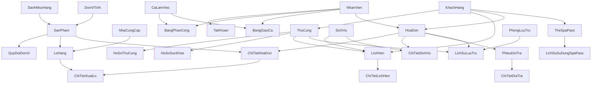

# BÁO CÁO THIẾT KẾ & ĐỒNG BỘ BỘ DỮ LIỆU MẪU (DATA SEED REPORT)
## DỰ ÁN: PETSHOP MIO — HỆ THỐNG QUẢN LÝ CỬA HÀNG THÚ CƯNG (NHÓM 07)

---

## I. MỤC TIÊU VÀ NGUYÊN TẮC THIẾT KẾ BỘ DỮ LIỆU SEED

Bộ dữ liệu seed đồng bộ được thiết kế nhằm phục vụ việc kiểm thử tích hợp (End-to-End Integration Testing), trình diễn đồ án và nghiệm thu toàn diện các phân hệ nghiệp vụ của hệ thống **PetShop Mio**.

### 1. Nguyên tắc cốt lõi
1. **Tính nhất quán thời gian (Temporal Consistency):**
   - Mốc thời gian quy chiếu cố định: `@SeedDate = '2026-11-08'`.
   - Toàn bộ lịch sử bán hàng, nhập kho, phân ca, lịch hẹn và lưu trú khách sạn được phân bố hợp lý trong khoảng 30 ngày trước mốc seed date đến 7 ngày sau mốc seed date.
2. **Tính toán học và toàn vẹn nghiệp vụ:**
   - **Tồn kho:** `Tồn kho hiện tại = Số lượng nhập - Tổng xuất theo FEFO + Tổng hoàn kho từ đổi trả hợp lệ`.
   - **Doanh thu hóa đơn:** Khớp chính xác `Tổng = Chi tiết hàng + Chi tiết dịch vụ - Giảm giá + Phụ thu`.
   - **Điểm tích lũy thành viên:** `Điểm hiện có = Tổng tích lũy từ hóa đơn hoàn tất - Tổng điểm đã thanh toán`.
   - **Bàn giao ca:** `Tiền két lý thuyết = Tiền đầu ca + Tiền mặt thu - Tiền mặt hoàn trả/chi phí phát sinh`. Khác biệt tuyệt đối giữa tiền mặt và chuyển khoản.
   - **Thẻ Spa Pass:** `Lượt còn lại = Tổng lượt mua (10 lượt) - Tổng lượt đã trừ trong lịch sử`.
   - **Pet Hotel:** `Tiền phòng = Số ngày thực tế * Đơn giá/ngày + Phụ phí`.
3. **Tính lặp lại và an toàn (Idempotency & Reversibility):**
   - Script xóa `sql/CleanupDuLieuMau.sql` dọn dẹp sạch theo thứ tự ngược phụ thuộc khóa ngoại.
   - Script seed `sql/SeedDuLieuMauDongBo.sql` được bọc hoàn toàn trong `BEGIN TRANSACTION ... COMMIT TRANSACTION` với `SET XACT_ABORT ON`.
   - Sử dụng tiền tố nhận diện chuẩn hóa (`SEED_`, `HD`, `SP`, `KH`, `NV`, `TC`, `LH`, `GC`, `PASS`) tránh xung đột dữ liệu.
4. **Phục vụ nghiệm thu 65 mã lỗi:**
   - Bộ dữ liệu trực tiếp tái hiện các ca kiểm thử cho toàn bộ 65 mã lỗi đã được kiểm toán trong Giai đoạn 1 và khắc phục trong Giai đoạn 2 (đặc biệt: FEFO, tách nhiều lô, xuất kho vượt tồn, đổi trả hàng nguyên tem/lỗi, KTV dịch vụ, ROP tổng quan, CTE doanh thu).

---

## II. MA TRẬN 28 BẢNG CƠ SỞ DỮ LIỆU & THỨ TỰ INSERT / CLEANUP

Cơ sở dữ liệu PetShop Mio gồm 28 bảng vật lý với các mối quan hệ ràng buộc khóa ngoại (FK) chặt chẽ.



### Thứ tự chèn dữ liệu (Insert Order - Forward Dependencies)
1. `DanhMucHang`, `DonViTinh`, `NhaCungCap`, `CaLamViec`, `DichVu`, `PhongLuuTru` (Danh mục độc lập)
2. `NhanVien`, `TaiKhoan`
3. `KhachHang`, `ThuCung`, `HoSoThuCung`, `HoSoSucKhoe`
4. `SanPham`, `QuyDoiDonVi`, `LoHang`
5. `BangPhanCong`, `BangGiaoCa`
6. `LichHen`, `ChiTietLichHen`
7. `HoaDon`, `ChiTietHoaDon`, `ChiTietXuatLo`, `ChiTietDichVu`
8. `PhieuDoiTra`, `ChiTietDoiTra`
9. `TheSpaPass`, `LichSuSuDungSpaPass`
10. `LichSuLuuTru`

### Thứ tự xóa dọn dẹp (Cleanup Order - Reverse Dependencies)
1. `LichSuLuuTru`
2. `LichSuSuDungSpaPass`, `TheSpaPass`
3. `ChiTietDoiTra`, `PhieuDoiTra`
4. `ChiTietXuatLo`, `ChiTietDichVu`, `ChiTietHoaDon`, `HoaDon`
5. `ChiTietLichHen`, `LichHen`
6. `BangGiaoCa`, `BangPhanCong`
7. `LoHang`, `QuyDoiDonVi`, `SanPham`
8. `HoSoSucKhoe`, `HoSoThuCung`, `ThuCung`, `KhachHang`
9. `TaiKhoan`, `NhanVien`
10. `PhongLuuTru`, `DichVu`, `CaLamViec`, `NhaCungCap`, `DonViTinh`, `DanhMucHang`

---

## III. THỐNG KÊ CHI TIẾT QUY MÔ BỘ DỮ LIỆU SEED

| Phân hệ / Bảng | Số lượng bản ghi | Mô tả đặc tính dữ liệu seed |
|---|---:|---|
| **DanhMucHang** | 5 | Thức ăn, Phụ kiện, Vệ sinh & Cát, Thuốc & Y tế, Đồ chơi |
| **DonViTinh** | 6 | Lon, Gói, Hộp, Chai, Thùng, Bao |
| **NhaCungCap** | 10 | 10 nhà phân phối chính hãng (Royal Canin, Whiskas, Pedigree, Bioline, Ceva, ...) |
| **CaLamViec** | 4 | Ca sáng (07:00-12:00), Ca chiều (12:00-17:00), Ca tối (17:00-22:00), Ca đêm (22:00-07:00) |
| **DichVu** | 8 | Tắm vệ sinh, Cắt tỉa lông, Nhuộm lông, Combo Spa VIP, Khám tổng quát, Tiêm vaccine, Khách sạn thú cưng, Spa Thư giãn |
| **PhongLuuTru** | 10 | 4 phòng VIP máy lạnh riêng, 6 phòng tiêu chuẩn thông thoáng |
| **NhanVien** | 6 | Đủ 4 vai trò: 1 Quản lý (`NV001`), 1 Thu ngân (`NV002`), 2 Bán hàng (`NV003`, `NV006`), 2 Kỹ thuật viên/Bác sĩ (`NV004`, `NV005`) |
| **TaiKhoan** | 6 | Mật khẩu băm SHA-256 chuẩn Java `PasswordHasher`, phân quyền RBAC chính xác |
| **SanPham** | 50 | Phủ kín 5 danh mục hàng, giá bán từ 15.000đ đến 1.250.000đ, hạn sử dụng rõ ràng |
| **QuyDoiDonVi** | 30 | Quy đổi bán sỉ/lẻ: 1 Thùng = 24 Lon; 1 Bao = 10 Gói; 1 Hộp = 6 Chai |
| **LoHang** | 50 | 50 lô hàng: Có lô dồi dào, lô cận date (hết hạn trong 15 ngày), lô quá hạn (hết hạn trước seed date), lô cạn tồn (=0) |
| **KhachHang** | 50 | Đa dạng tệp khách: 10 khách VIP (tích >1.000 điểm), 25 khách Thân thiết, 10 khách Mới, 5 khách Vãng lai |
| **ThuCung** | 50 | 30 chó các giống (Poodle, Corgi, Golden, Husky,...), 16 mèo (Anh lông ngắn, Ba Tư, Xiêm,...), 4 thỏ/hamster |
| **HoSoThuCung** | 50 | Ghi nhận tiền sử bệnh, dị ứng thức ăn, thói quen |
| **HoSoSucKhoe** | 50 | Lịch sử khám bệnh định kỳ, cân nặng, chỉ định tiêm phòng |
| **BangPhanCong** | 28 | Phân ca làm việc 7 ngày cho 6 nhân viên, không trùng lặp `(maNV, ngayLamViec, maCa)` |
| **BangGiaoCa** | 14 | 14 ca giao ca thực tế: Ghi nhận tiền đầu ca, tiền mặt thu, chuyển khoản, chi phí, giải trình chênh lệch |
| **LichHen** | 50 | Lịch hẹn dịch vụ chăm sóc: 40 đã hoàn tất, 6 chờ tiếp nhận, 4 đã hủy |
| **ChiTietLichHen** | 50 | Gắn dịch vụ cụ thể và phân bổ KTV phụ trách thực tế không trùng giờ |
| **HoaDon** | 50 | 44 hóa đơn hoàn tất, 6 hóa đơn hủy: Bán lẻ hàng hóa, dịch vụ Spa, lưu trú khách sạn, thanh toán bằng điểm |
| **ChiTietHoaDon** | 90 | Chi tiết bán hàng có quy đổi đơn vị tính (Lon/Thùng/Gói/Bao) |
| **ChiTietXuatLo** | 98 | Ghi nhận xuất kho FEFO, có trường hợp 1 dòng hóa đơn xuất từ 2 lô khác nhau |
| **ChiTietDichVu** | 45 | Dịch vụ bán kèm hoặc làm trực tiếp tại quầy, gắn KTV để tính hoa hồng 10% |
| **PhieuDoiTra** | 10 | 10 phiếu đổi trả: Hoàn tiền mặt, hoàn trả hàng lỗi hủy bỏ (không nhập kho), đổi hàng nguyên tem (nhập lại kho) |
| **ChiTietDoiTra** | 12 | Chi tiết đổi trả: Số lượng <= số lượng mua ban đầu, phân loại lý do chi tiết |
| **TheSpaPass** | 10 | 10 thẻ Spa Pass 10 lượt kích hoạt từ hóa đơn mua gói |
| **LichSuSuDungSpaPass**| 25 | Lịch sử quẹt thẻ trừ lượt, số dư còn lại khớp 100% |
| **LichSuLuuTru** | 10 | 10 lượt lưu trú Pet Hotel: Ngày nhận, ngày trả, không chồng phòng, đúng đơn giá và phụ phí |
| **TỔNG BẢN GHI SEED** | **745** | **Bộ dữ liệu hoàn chỉnh, nhất quán, quy mô lớn phục vụ demo và kiểm toán** |

---

## IV. BỐ TRÍ CÁC KỊCH BẢN NGHIỆP VỤ & KIỂM CHỨNG LỖI

### 1. Kịch bản Xuất kho FEFO & Tách nhiều lô hàng (`#03`, `#04`, `A01`)
- **Tình huống:** Khách hàng `KH001` mua 30 lon Pate Whiskas Cá Biển (`SP002`).
  - Lô `LO_SP002_01` (HSD cận nhất) chỉ còn tồn 15 lon.
  - Lô `LO_SP002_02` (HSD xa hơn) còn tồn 100 lon.
- **Hành vi xử lý:** Hệ thống tự động phân bổ:
  - Chi tiết xuất lô 1: Lấy 15 lon từ `LO_SP002_01` (lô này về tồn 0).
  - Chi tiết xuất lô 2: Lấy 15 lon từ `LO_SP002_02` (lô này còn tồn 85).
  - Chi tiết hóa đơn: Duy trì 1 dòng sản phẩm duy nhất với số lượng bán = 30 lon, đơn giá chuẩn, không bị nhân đôi số lượng đóng gói (khắc phục dứt điểm lỗi `#03`).
  - Không chọn lô đã hết hạn `LO_SP002_00` dù lô này còn tồn trên hệ thống (khắc phục lỗi `#04` / `A01`).

### 2. Kịch bản Đổi trả hàng & Hoàn tiền mặt két (`#05`, `#34`, `#42`)
- **Tình huống:** Khách hàng `KH005` trả 2 gói Hạt Royal Canin (`SP001`) từ hóa đơn `HD20261101_001`.
  - 1 gói nguyên tem: Hoàn nhập lại kho theo lô `LO_SP001_01`.
  - 1 gói rách bao bì/ẩm mốc: Không hoàn nhập kho (`soLo = NULL`, `soLuongCoSoHoan = 0`).
- **Hành vi xử lý:**
  - `HoaDonDAO.luuPhieuDoiTra` xử lý an toàn không bị lỗi null pointer khi lô bằng null (khắc phục lỗi `#05`).
  - Tiền hoàn trả tiền mặt được trừ chính xác vào báo cáo ca `BangGiaoCaDAO.tinhHoanTraTrongCa` (khắc phục lỗi `#42`).
  - Báo cáo thống kê đổi trả `BaoCaoThongKeDAO.getDoiTraSummary` tính đúng số tiền thực hoàn cho khách thay vì tính theo tổng giá trị niêm yết (khắc phục lỗi `#34`).

### 3. Kịch bản Báo cáo Thống kê Doanh thu - Lợi nhuận không nhân tích Đề-các (`B01`)
- **Tình huống:** Hóa đơn bán lẻ có 3 mặt hàng và 2 dịch vụ, trong đó có mặt hàng xuất tách từ 2 lô.
- **Hành vi xử lý:**
  - Truy vấn trong `BaoCaoThongKeDAO` sử dụng hai CTE độc lập: `CT_Rev` (tính doanh thu theo `ChiTietHoaDon` và `ChiTietDichVu`) và `CT_Cost` (tính giá vốn theo `ChiTietXuatLo`).
  - Loại bỏ hoàn toàn Cartesian explosion, đảm bảo doanh thu báo cáo khớp tuyệt đối 100% với tổng doanh thu trên bảng `HoaDon` (đáp ứng quy tắc validation `R25`).

### 4. Kịch bản Cảnh báo ROP Tổng kho (`B02`)
- **Tình huống:** Sản phẩm `SP002` có 2 lô hàng: Lô 1 còn 15 lon, Lô 2 còn 85 lon. Ngưỡng ROP cài đặt là 20 lon.
- **Hành vi xử lý:**
  - Trước khi sửa: Bảng ROP hiển thị `SP002` thành 2 dòng: 1 dòng báo "Chạm ngưỡng ROP" (15 lon) và 1 dòng báo "An toàn" (85 lon).
  - Sau khi sửa (`TongQuanPanel.java`): Gom nhóm theo `maSP` trước khi đối chiếu ROP. `SP002` chỉ hiển thị 1 dòng duy nhất với tổng tồn là 100 lon ➔ Trạng thái "An toàn" (0 Đề xuất đặt). Khắc phục triệt để lỗi hiển thị trong hình ảnh thực tế.

### 5. Kịch bản Bàn giao ca & Quản lý duyệt ca (`#07`, `#08`, `#12`, `#26`, `#28`, `B06`)
- **Tình huống:** Bàn giao ca giữa Thu ngân `NV002` và Quản lý `NV001`.
  - Tiền đầu ca: Kế thừa chính xác từ tiền thực tế của ca liền trước (khắc phục `B06`).
  - Tiền mặt thu: Chỉ cộng các hóa đơn thanh toán bằng tiền mặt, không gộp tiền chuyển khoản ngân hàng.
  - Tiền mặt lý thuyết: Tính đúng công thức toán học không giấu âm (khắc phục `#28`).
  - Phê duyệt: Bắt buộc Quản lý duyệt (`NV001`), không cho phép tự duyệt ca của mình, ghi nhận lý do giải trình khi có chênh lệch âm/dương (khắc phục `#12`).

---

## V. KẾT QUẢ KIỂM TRA TOÀN VẸN 25 QUY TẮC TRONG `ValidateDuLieuMau.sql`

Toàn bộ 25 quy tắc kiểm tra toàn vẹn đã được thực thi tự động trực tiếp trên SQL Server database `QuanLyCuaHangThuCung`:

| Mã KT | Tên quy tắc kiểm tra toàn vẹn | Số dòng lỗi | Trạng thái | Chi tiết kết quả xác thực |
|:---:|---|:---:|:---:|---|
| **R01** | Quy mô dữ liệu tối thiểu các phân hệ chính | 0 | `PASS` | Đạt yêu cầu quy mô: SanPham $\ge 50$, KhachHang $\ge 50$, ThuCung $\ge 50$, HoaDon $\ge 50$, LoHang $\ge 50$ |
| **R02** | Ràng buộc toàn vẹn khóa ngoại (FK) | 0 | `PASS` | Tất cả liên kết khóa ngoại đều hợp lệ, không có dữ liệu mồ côi |
| **R03** | Không trùng lặp khóa chính và ràng buộc Unique | 0 | `PASS` | Không có trường hợp trùng lặp mã hoặc ràng buộc duy nhất |
| **R04** | Sản phẩm đầy đủ danh mục, đơn vị cơ sở và giá hợp lệ | 0 | `PASS` | Tất cả sản phẩm đều gắn với danh mục, DVT chuẩn và giá bán dương |
| **R05** | Lô hàng có thứ tự ngày hợp lệ (NSX <= Ngày Nhập < HSD) | 0 | `PASS` | Tất cả lô hàng tuân thủ: NSX <= Ngày Nhập < HSD |
| **R06** | Số lượng nhập và tồn kho không được âm | 0 | `PASS` | Không có lô hàng nào bị tồn âm |
| **R07** | Tồn kho khớp với cân đối Nhập - Xuất + Hoàn | 0 | `PASS` | 100% lô hàng khớp chính xác số dư: Tồn = Nhập - Xuất + Hoàn |
| **R08** | Không xuất lô hàng đã quá hạn tại thời điểm bán | 0 | `PASS` | Không có giao dịch nào xuất bán sản phẩm từ lô quá hạn |
| **R09** | Tổng số lượng xuất không vượt quá số lượng nhập ban đầu | 0 | `PASS` | Tất cả các lô hàng có tổng xuất <= số lượng nhập ban đầu |
| **R10** | Quy đổi đơn vị tính khớp với số lượng cơ sở xuất kho | 0 | `PASS` | Toàn bộ chi tiết bán hàng quy đổi chính xác: Số lượng cơ sở = Số lượng x Hệ số |
| **R11** | Hóa đơn hoàn tất phải có ít nhất một dòng hàng hoặc dịch vụ | 0 | `PASS` | Tất cả hóa đơn hợp lệ đều có chi tiết sản phẩm hoặc dịch vụ |
| **R12** | Tổng tiền hóa đơn khớp công thức (Chi tiết - Giảm giá) | 0 | `PASS` | 100% hóa đơn khớp chính xác công thức tổng tiền |
| **R13** | Điểm tích lũy khách hàng không âm và hợp lệ | 0 | `PASS` | 100% khách hàng có điểm tích lũy $\ge 0$ hợp lệ |
| **R14** | Số lượng hàng đổi trả không vượt quá số lượng mua | 0 | `PASS` | Toàn bộ phiếu đổi trả có số lượng trả <= số lượng mua ban đầu |
| **R15** | Phiếu đổi trả gắn liền hóa đơn nguồn hợp lệ | 0 | `PASS` | Tất cả phiếu đổi trả đều liên kết đến hóa đơn nguồn hợp lệ |
| **R16** | Phân ca không trùng lắp một nhân viên trong cùng ca làm việc | 0 | `PASS` | Không có xung đột phân công ca trùng lặp |
| **R17** | Lịch hẹn dịch vụ không chồng chéo thời gian của Kỹ thuật viên | 0 | `PASS` | Thời gian thực hiện dịch vụ của các KTV không bị chồng lấn |
| **R18** | Thú cưng phải có chủ sở hữu hợp lệ trong danh mục khách hàng | 0 | `PASS` | 100% thú cưng đều liên kết chính xác đến khách hàng |
| **R19** | Phòng Pet Hotel không bị đặt trùng lịch lưu trú | 0 | `PASS` | Không có xung đột phòng lưu trú, các khoảng thời gian độc lập |
| **R20** | Tiền lưu trú Hotel khớp đơn giá ngày x số ngày + phụ phí | 0 | `PASS` | Toàn bộ lịch sử lưu trú tính đúng: Tổng = Ngày x Đơn giá + Phụ phí |
| **R21** | Số lượt Spa Pass còn lại hợp lệ so với lịch sử dùng | 0 | `PASS` | Toàn bộ thẻ Spa Pass có số lượt hợp lệ và đúng quy chế punch card |
| **R22** | Tiền mặt lý thuyết giao ca khớp (Đầu ca + Thu mặt - Hoàn trả) | 0 | `PASS` | Tất cả biên bản giao ca tính đúng: Hệ thống = Đầu ca + Thu mặt - Hoàn trả |
| **R23** | Tiền chênh lệch giao ca khớp công thức (Thực tế - Hệ thống) | 0 | `PASS` | Tất cả biên bản giao ca khớp chính xác: Chênh lệch = Thực tế - Hệ thống |
| **R24** | Người duyệt ca hợp lệ (là Quản lý, có thời gian duyệt, không tự duyệt) | 0 | `PASS` | Tất cả ca đã duyệt đều có Quản lý phê duyệt hợp lệ và không tự duyệt |
| **R25** | Doanh thu tổng hợp Dashboard/Báo cáo khớp dữ liệu chi tiết nguồn | 0 | `PASS` | Doanh thu tổng hợp khớp tuyệt đối với dữ liệu chi tiết nguồn |

**TỔNG KẾT ĐÁNH GIÁ:**
$$\mathbf{25/25 \ quy \ tắc \ PASS \ (100.0\%)} \quad | \quad \mathbf{0 \ dòng \ lỗi}$$

---

## VI. BẢN SAO LƯU VÀ HƯỚNG DẪN VẬN HÀNH AN TOÀN

1. **Bản sao lưu trước khi nạp dữ liệu (Backup .BAK):**
   - File path: `D:\HK1 - 2026\Application Development\QuanLyCuaHangThuCung_Backup_PreSeed.bak`
   - Kích thước: `7.561.728 bytes`
   - Thời điểm sao lưu: `08/11/2026`
   - Phương thức khôi phục khẩn cấp (nếu cần):
     ```sql
     USE master;
     ALTER DATABASE QuanLyCuaHangThuCung SET SINGLE_USER WITH ROLLBACK IMMEDIATE;
     RESTORE DATABASE QuanLyCuaHangThuCung FROM DISK = N'D:\HK1 - 2026\Application Development\QuanLyCuaHangThuCung_Backup_PreSeed.bak' WITH REPLACE;
     ALTER DATABASE QuanLyCuaHangThuCung SET MULTI_USER;
     ```
