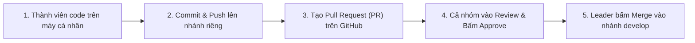

# 📘 SỔ TAY HƯỚNG DẪN GIT & PULL REQUEST CẦM TAY CHỈ VIỆC
> **Dành cho:** Thành viên Nhóm 07 - Đề tài Hệ Thống Quản Lý Cửa Hàng Thú Cưng  
> **Mục tiêu:** Hướng dẫn từ A - Z cho các bạn chưa từng dùng Git, đảm bảo đẩy code chuẩn xác, không bị lỗi xung đột, có đầy đủ Code Review chéo để lấy điểm tối đa môn học.

---

## 🎯 NGUYÊN TẮC LÀM VIỆC CỦA CẢ NHÓM



1. **Tuyệt đối không đụng vào nhánh `main`:** Nhánh `main` là "bất khả xâm phạm", chỉ dùng nộp cho giảng viên.
2. **Mỗi người 1 nhánh riêng:** Không ai nhảy vào nhánh của người khác.
3. **Mọi dòng code muốn gộp chung đều phải qua PULL REQUEST (PR):** Cả nhóm xem qua, bấm "Approve" (Đồng ý) thì mới được Merge. Giảng viên nhìn vào phần thảo luận này sẽ cho điểm kỹ năng làm việc nhóm rất cao!

---

## BƯỚC 0: CÀI ĐẶT BAN ĐẦU (CHỈ LÀM 1 LẦN DUY NHẤT)

### 1. Cấu hình định danh (Bắt buộc để biểu đồ GitHub hiện đúng tên bạn)
Mở cửa sổ **Git Bash** (hoặc Terminal / PowerShell) trên máy tính của bạn và gõ 2 lệnh sau:

```bash
git config --global user.name "Họ và Tên Của Bạn"
git config --global user.email "email_ban_dung_dang_ky_github@gmail.com"
```
> [!IMPORTANT]
> **Email phải trùng 100%** với email bạn dùng đăng ký tài khoản GitHub. Nếu gõ sai email, commit sẽ thành "người lạ" và biểu đồ đóng góp của bạn trên GitHub sẽ bị trắng tinh!

### 2. Tải mã nguồn dự án về máy (Clone)
```bash
# 1. Mở thư mục muốn lưu code (ví dụ D:\HocTap)
cd D:\HocTap

# 2. Clone repository về máy
git clone https://github.com/<tai-khoan-leader>/Repo_Group07-HeThongQuanLyCuaHangThuCung.git

# 3. Đi vào thư mục dự án
cd Repo_Group07-HeThongQuanLyCuaHangThuCung
```

---

## BƯỚC 1: TẠO VÀ CHUYỂN SANG NHÁNH RIÊNG CỦA BẠN

Mỗi thành viên chỉ làm việc trên đúng nhánh được phân công:

<table border="1" style="border-collapse: collapse; width: 100%; border: 1px solid #cbd5e1;">
  <thead>
    <tr style="background-color: #f1f5f9;">
      <th style="padding: 8px; border: 1px solid #cbd5e1;">Thành viên</th>
      <th style="padding: 8px; border: 1px solid #cbd5e1;">Tên nhánh riêng của bạn</th>
      <th style="padding: 8px; border: 1px solid #cbd5e1;">Phân hệ phụ trách</th>
    </tr>
  </thead>
  <tbody>
    <tr>
      <td style="padding: 8px; border: 1px solid #cbd5e1;"><b>Lê Khãi Minh</b></td>
      <td style="padding: 8px; border: 1px solid #cbd5e1;"><code>feature/pos-ban-hang-doi-tra</code></td>
      <td style="padding: 8px; border: 1px solid #cbd5e1;">Bán hàng POS, In hóa đơn, Đổi trả hàng, VietQR, VNPay</td>
    </tr>
    <tr>
      <td style="padding: 8px; border: 1px solid #cbd5e1;"><b>Tô Thanh Đạt</b></td>
      <td style="padding: 8px; border: 1px solid #cbd5e1;"><code>feature/kho-san-pham-lo-hang</code></td>
      <td style="padding: 8px; border: 1px solid #cbd5e1;">Quản lý kho, Sản phẩm, Lô hàng FEFO, Quy đổi đơn vị</td>
    </tr>
    <tr>
      <td style="padding: 8px; border: 1px solid #cbd5e1;"><b>Võ Thị Hồng Ngọc</b></td>
      <td style="padding: 8px; border: 1px solid #cbd5e1;"><code>feature/thu-cung-dich-vu-hotel</code></td>
      <td style="padding: 8px; border: 1px solid #cbd5e1;">Hồ sơ thú cưng, Sức khỏe, Đặt lịch Spa, Pet Hotel</td>
    </tr>
    <tr>
      <td style="padding: 8px; border: 1px solid #cbd5e1;"><b>Lê Anh Minh</b></td>
      <td style="padding: 8px; border: 1px solid #cbd5e1;"><code>feature/nhan-su-giao-ca-dashboard</code></td>
      <td style="padding: 8px; border: 1px solid #cbd5e1;">Đăng nhập, Nhân viên, Phân ca, Bàn giao ca, Dashboard</td>
    </tr>
  </tbody>
</table>

**Lệnh tạo và nhảy vào nhánh riêng:**
```bash
# Cú pháp: git checkout -b feature/<ten-nhanh-cua-ban> origin/develop
# Ví dụ bạn Tô Thanh Đạt:
git checkout -b feature/kho-san-pham-lo-hang
```

---

## BƯỚC 2: QUY TRÌNH CODE & PUSH CODE HẰNG NGÀY (4 LỆNH CƠ BẢN)

Mỗi ngày, sau khi copy hoặc viết xong 1-3 file Java của mình vào đúng thư mục, bạn mở Terminal tại thư mục dự án và làm đúng 4 bước:

```bash
# 1. Kiểm tra xem mình vừa sửa hoặc thêm file nào (các file sẽ hiện màu đỏ)
git status

# 2. Thêm các file bạn vừa làm vào danh sách chuẩn bị lưu
# (Ví dụ bạn Đạt thêm file Sản Phẩm):
git add src/models/entity/SanPham.java src/models/dao/SanPhamDAO.java

# 3. Đóng gói lại kèm thông điệp (Commit message) rõ ràng:
git commit -m "feat(kho): create SanPham entity and DAO queries"

# 4. Đẩy lên GitHub:
git push -u origin feature/<ten-nhanh-cua-ban>
```

> [!TIP]
> **Quy ước đặt tên thông điệp commit (Commit Message chuẩn Conventional Commits):**
> - Tạo file Entity / Model mới: `git commit -m "feat(entity): add SanPham and DanhMucHang models"`
> - Viết câu truy vấn CSDL: `git commit -m "feat(dao): implement SanPhamDAO with search and filter"`
> - Thiết kế giao diện: `git commit -m "feat(view): design KhoLoHangPanel layout and tables"`
> - Bắt sự kiện / logic: `git commit -m "feat(logic): calculate FEFO expiry date warning"`
> - Sửa lỗi: `git commit -m "fix(pos): fix change money calculation bug"`

---

## BƯỚC 3: HƯỚNG DẪN THAO TÁC TRÊN GIAO DIỆN ECLIPSE (DÀNH CHO BẠN NÀO NGẠI DÙNG LỆNH)

Nếu bạn không quen dùng Terminal đen, có thể bấm chuột 100% trong Eclipse:

1. **Thêm file (Git Add):**
   - Chuột phải vào file vừa sửa trong thanh *Package Explorer* $\rightarrow$ chọn **Team** $\rightarrow$ chọn **Add to Index**.
2. **Lưu lịch sử (Git Commit):**
   - Chuột phải vào Project $\rightarrow$ **Team** $\rightarrow$ **Commit...**
   - Cửa sổ *Git Staging* sẽ hiện ra.
   - Gõ thông điệp commit vào ô *Commit Message*.
3. **Đẩy lên GitHub (Git Push):**
   - Bấm nút **Commit and Push** ở góc dưới bên phải cửa sổ *Git Staging*.
   - Nhập thông tin đăng nhập GitHub (hoặc Personal Access Token) nếu Eclipse hỏi $\rightarrow$ Xong!

---

## BƯỚC 4: QUY TRÌNH CODE REVIEW & MERGE (QUAN TRỌNG NHẤT)

Khi một bạn đã hoàn thành phân hệ của mình và muốn gộp code vào dự án chung, **KHÔNG ĐƯỢC TỰ Ý MERGE**, mà thực hiện theo 3 bước sau:

### 1. Người viết code: Mở Pull Request (PR) trên web GitHub
1. Vào trang GitHub của nhóm trên trình duyệt web.
2. Bạn sẽ thấy một thông báo màu vàng hiện ra: `feature/... had recent pushes` $\rightarrow$ bấm nút **Compare & pull request** (hoặc vào tab **Pull requests** $\rightarrow$ bấm **New pull request**).
3. **Chọn nhánh:**
   - `base:` chọn **`develop`** (tuyệt đối không chọn `main`).
   - `compare:` chọn nhánh của bạn (ví dụ `feature/kho-san-pham-lo-hang`).
4. **Điền tiêu đề & Mô tả:**
   - Tiêu đề: `[Feature] Hoàn thiện phân hệ Quản lý Kho & Lô hàng FEFO`
   - Mô tả: Liệt kê các chức năng đã làm xong, đính kèm ảnh chụp màn hình chạy thử.
5. Tại cột bên phải mục **Reviewers**: Bấm chọn 3 bạn còn lại trong nhóm vào để mời review.
6. Bấm nút màu xanh **Create pull request**.

---

### 2. Các thành viên còn lại: Vào Review Code chéo
1. Mở trang Pull Request mà bạn của mình vừa tạo.
2. Bấm vào tab **Files changed** (ở cạnh tab Conversation):
   - Bạn sẽ thấy toàn bộ code mà bạn mình đã viết (dòng màu xanh là thêm mới).
   - Có thể bấm vào từng dòng code để để lại bình luận nhận xét (ví dụ: *"Đoạn tính ngày FEFO này viết rất chuẩn"*, *"Nên format lại tiền tệ nhé"*...).
3. Sau khi kiểm tra thấy code chạy ổn định:
   - Bấm nút màu xanh **Review changes** ở góc trên bên phải.
   - Chọn **Approve** (Đồng ý).
   - Gõ nhận xét: *"Code sạch, đã test giao diện hiển thị tốt, duyệt merge!"*
   - Bấm **Submit review**.

---

### 3. Trưởng nhóm (Leader): Bấm Merge hoàn tất
Khi PR đã có đủ ít nhất 1 - 2 lượt **Approved** từ các thành viên:
1. Leader kiểm tra lại mục kiểm tra tự động xem có báo xanh `Able to merge` không.
2. Bấm nút màu xanh **Merge pull request** $\rightarrow$ Chọn **Confirm merge**.
3. Bấm **Delete branch** (để dọn dẹp các nhánh đã hoàn thành cho repo gọn gàng).

---

## BƯỚC 5: ĐỒNG BỘ CODE MỚI VỀ MÁY (KHI BẠN KHÁC ĐÃ MERGE)

Khi có một bạn trong nhóm vừa được merge code mới vào `develop`, các bạn còn lại muốn cập nhật code mới nhất về máy mình để không bị lạc hậu:

```bash
# 1. Chuyển về nhánh develop trên máy bạn
git checkout develop

# 2. Kéo code mới nhất từ GitHub về
git pull origin develop

# 3. Quay lại nhánh của bạn và cập nhật code mới vào
git checkout feature/<nhanh-cua-ban>
git merge develop
```
*(Nếu dùng Eclipse: Chuột phải vào Project $\rightarrow$ **Team** $\rightarrow$ **Pull...**)*.

---

### 🏆 TỔNG KẾT: BẢNG CHECKLIST CHO MỖI THÀNH VIÊN
- [ ] Đã chạy `git config` đúng Họ tên và Email GitHub.
- [ ] Chỉ làm việc trên nhánh `feature/...` của riêng mình.
- [ ] Mỗi ngày commit 1 - 2 lần, băm nhỏ từng file, thông điệp rõ ràng.
- [ ] Làm xong thì mở **Pull Request** lên nhánh `develop`.
- [ ] Nhắc nhau vào tab **Files changed** để đọc code và bấm **Approve**.
- [ ] Leader duyệt và bấm **Merge pull request**.
