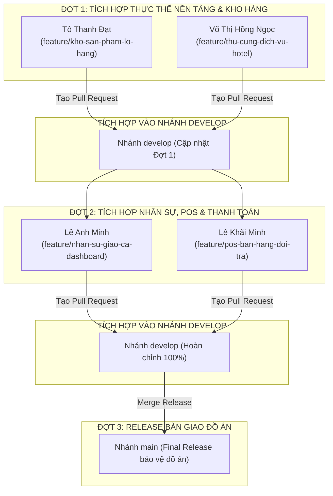

# 📋 KẾ HOẠCH PHÂN CHIA VÀ QUY TRÌNH PUSH CODE - NHÓM 07
> **Đồ án học phần:** Phát triển Ứng dụng (Application Development)  
> **Đơn vị:** Khoa Công nghệ Thông tin - Trường Đại học Công nghiệp TP.HCM (IUH)  
> **Đề tài:** Hệ thống Quản lý Cửa hàng Thú cưng (Pet Shop Management System)  
> **Nhóm thực hiện:** Nhóm 07 (N07)  
> **Mục tiêu:** Phân chia mã nguồn độc lập, lộ trình tích hợp theo đợt rõ ràng, đảm bảo biểu đồ đóng góp (GitHub Contributors) của cả 4 thành viên đồng đều và minh bạch.

---

## 👥 1. BẢNG PHÂN CHIA NHIỆM VỤ VÀ GÓI MÃ NGUỒN

| STT | Họ và Tên | Vai trò | Phân hệ nghiệp vụ phụ trách | Tên nhánh Git (Feature Branch) | Thư mục gói code |
| :---: | :--- | :---: | :--- | :--- | :--- |
| **1** | **Tô Thanh Đạt** | Thành viên | Quản lý Kho hàng, Danh mục sản phẩm, Lô hàng FEFO (hạn sử dụng), Quy đổi đơn vị tính đa cấp | `feature/kho-san-pham-lo-hang` | `phan_chia_code_4_thanh_vien/GoiCode_2_ToThanhDat/` |
| **2** | **Võ Thị Hồng Ngọc** | Thành viên | Hồ sơ thú cưng, Sổ theo dõi sức khỏe, Lịch hẹn dịch vụ/Spa, Phòng khách sạn thú cưng (Pet Hotel) | `feature/thu-cung-dich-vu-hotel` | `phan_chia_code_4_thanh_vien/GoiCode_3_VoThiHongNgoc/` |
| **3** | **Lê Anh Minh** | Thành viên | Quản lý Nhân sự, Đăng nhập & phân quyền RBAC 4 vai trò, Xếp ca tuần, Bàn giao ca thu ngân, Dashboard báo biểu | `feature/nhan-su-giao-ca-dashboard` | `phan_chia_code_4_thanh_vien/GoiCode_4_LeAnhMinh/` |
| **4** | **Lê Khãi Minh** | Trưởng nhóm | Bán hàng POS, Holding Carts, In hóa đơn bán lẻ, Đổi trả hàng hóa, Cổng VietQR Napas 247 & VNPay Sandbox | `feature/pos-ban-hang-doi-tra` | `phan_chia_code_4_thanh_vien/GoiCode_1_LeKhaiMinh/` |

---

## 🗓️ 2. LỘ TRÌNH TÍCH HỢP CODE THEO ĐỢT (GIT WORKFLOW ROADMAP)

Để đảm bảo không bị xung đột phụ thuộc giữa các class (Dependency Inversion), nhóm triển khai tích hợp theo **3 đợt**:

---

## 📦 3. CHI TIẾT DANH SÁCH FILE & KẾ HOẠCH BĂM COMMIT TỪNG THÀNH VIÊN

> [!IMPORTANT]
> **Quy tắc vàng:** Không commit tất cả các file trong 1 lần. Mỗi bạn băm nhỏ thành **3 commit riêng biệt** (Entity $\rightarrow$ DAO $\rightarrow$ View/Controller). Điều này giúp lịch sử Git chuyên nghiệp và tăng số lượng commit trên GitHub đóng góp.

---

### 1️⃣ Tô Thanh Đạt — Nhánh `feature/kho-san-pham-lo-hang` (Tổng: 11 files)

- **Commit 1 (Entity):**
  - Thông điệp: `feat(entity): create SanPham, LoHang, QuyDoiDonVi, DanhMucHang, NhaCungCap models`
  - Danh sách file:
    - `src/models/entity/DanhMucHang.java`
    - `src/models/entity/DonViTinh.java`
    - `src/models/entity/NhaCungCap.java`
    - `src/models/entity/SanPham.java`
    - `src/models/entity/QuyDoiDonVi.java`
    - `src/models/entity/LoHang.java`
- **Commit 2 (DAO):**
  - Thông điệp: `feat(dao): implement SanPhamDAO and LoHangDAO for FEFO stock management`
  - Danh sách file:
    - `src/models/dao/SanPhamDAO.java`
    - `src/models/dao/LoHangDAO.java`
- **Commit 3 (Giao diện & Nghiệp vụ):**
  - Thông điệp: `feat(view): add KhoLoHangPanel, ThietLapQuyDoiDialog and NhapSanPhamVaLoHangDialog`
  - Danh sách file:
    - `src/views/KhoLoHangPanel.java`
    - `src/views/ThietLapQuyDoiDialog.java`
    - `src/views/NhapSanPhamVaLoHangDialog.java`

---

### 2️⃣ Võ Thị Hồng Ngọc — Nhánh `feature/thu-cung-dich-vu-hotel` (Tổng: 16 files)

- **Commit 1 (Entity):**
  - Thông điệp: `feat(entity): add ThuCung, HoSoThuCung, HoSoSucKhoe, DichVu, LichHen models`
  - Danh sách file:
    - `src/models/entity/ThuCung.java`
    - `src/models/entity/HoSoThuCung.java`
    - `src/models/entity/HoSoSucKhoe.java`
    - `src/models/entity/DichVu.java`
    - `src/models/entity/LichHen.java`
    - `src/models/entity/ChiTietLichHen.java`
- **Commit 2 (DAO):**
  - Thông điệp: `feat(dao): implement ThuCungDAO, DichVuDAO, LichHenDAO and PhongLuuTruDAO`
  - Danh sách file:
    - `src/models/dao/ThuCungDAO.java`
    - `src/models/dao/DichVuDAO.java`
    - `src/models/dao/LichHenDAO.java`
    - `src/models/dao/PhongLuuTruDAO.java`
- **Commit 3 (Controller & Giao diện):**
  - Thông điệp: `feat(view): add ThuCungDichVuPanel, PetHotelPanel, QuanLyLichHenPanel and dialogs`
  - Danh sách file:
    - `src/controllers/ThuCungController.java`
    - `src/views/ThuCungDichVuPanel.java`
    - `src/views/PetHotelPanel.java`
    - `src/views/QuanLyLichHenPanel.java`
    - `src/views/DatLichHenDialog.java`
    - `src/views/ChonDichVuDialog.java`

---

### 3️⃣ Lê Anh Minh — Nhánh `feature/nhan-su-giao-ca-dashboard` (Tổng: 22 files)

- **Commit 1 (Entity):**
  - Thông điệp: `feat(entity): add TaiKhoan, NhanVien, CaLamViec, BangPhanCong, BangGiaoCa models`
  - Danh sách file:
    - `src/models/entity/TaiKhoan.java`
    - `src/models/entity/NhanVien.java`
    - `src/models/entity/CaLamViec.java`
    - `src/models/entity/BangPhanCong.java`
    - `src/models/entity/BangGiaoCa.java`
- **Commit 2 (DAO & Controllers):**
  - Thông điệp: `feat(dao): implement TaiKhoanDAO, NhanVienDAO, PhanCaDAO, BangGiaoCaDAO and controllers`
  - Danh sách file:
    - `src/models/dao/TaiKhoanDAO.java`
    - `src/models/dao/NhanVienDAO.java`
    - `src/models/dao/PhanCaDAO.java`
    - `src/models/dao/BangGiaoCaDAO.java`
    - `src/controllers/DangNhapController.java`
    - `src/controllers/NhanVienController.java`
    - `src/controllers/PhanCaController.java`
    - `src/controllers/GiaoCaController.java`
- **Commit 3 (Giao diện View & Dashboard Graphics2D):**
  - Thông điệp: `feat(view): implement MainDashboard, LoginForm, QuanLyNhanVienPanel, BanGiaoCaPanel and Charts`
  - Danh sách file:
    - `src/views/LoginForm.java`
    - `src/views/MainDashboard.java`
    - `src/views/QuanLyNhanVienPanel.java`
    - `src/views/LichPhanCaPanel.java`
    - `src/views/BanGiaoCaPanel.java`
    - `src/views/TongQuanPanel.java`
    - `src/views/BaoCaoThongKeDialog.java`
    - `src/views/charts/BarChartPanel.java`
    - `src/views/charts/DonutChartPanel.java`

---

### 4️⃣ Lê Khãi Minh (Leader) — Nhánh `feature/pos-ban-hang-doi-tra` (Tổng: 15 files)

- **Commit 1 (Entity):**
  - Thông điệp: `feat(entity): add KhachHang, HoaDon, ChiTietHoaDon, ChiTietXuatLo, ChiTietDichVu, PhieuDoiTra models`
  - Danh sách file:
    - `src/models/entity/KhachHang.java`
    - `src/models/entity/HoaDon.java`
    - `src/models/entity/ChiTietHoaDon.java`
    - `src/models/entity/ChiTietXuatLo.java`
    - `src/models/entity/ChiTietDichVu.java`
    - `src/models/entity/PhieuDoiTra.java`
    - `src/models/entity/ChiTietDoiTra.java`
- **Commit 2 (DAO & Controller):**
  - Thông điệp: `feat(dao): implement HoaDonDAO with atomic transaction, KhachHangDAO and BanHangController`
  - Danh sách file:
    - `src/models/dao/KhachHangDAO.java`
    - `src/models/dao/HoaDonDAO.java`
    - `src/controllers/BanHangController.java`
- **Commit 3 (Giao diện POS, VietQR, VNPay & Đổi trả):**
  - Thông điệp: `feat(view): build BanHangPOSPanel, VietQRDialog, VNPayDialog, DoiTraHangPanel and invoice print preview`
  - Danh sách file:
    - `src/views/BanHangPOSPanel.java`
    - `src/views/HoaDonPreviewDialog.java`
    - `src/views/VietQRDialog.java`
    - `src/views/VNPayDialog.java`
    - `src/views/DoiTraHangPanel.java`

---

## 🔍 4. QUY TRÌNH CODE REVIEW VÀ PHÂN CÔNG DUYỆT PULL REQUEST

Để giảng viên thấy rõ kỹ năng làm việc nhóm thực thụ, các thành viên sẽ Review chéo lẫn nhau:

| Pull Request | Người tạo PR | Người thực hiện Review & Approve | Người bấm Merge | Nhánh đích |
| :--- | :--- | :--- | :--- | :--- |
| **PR 1: Kho & Lô hàng FEFO** | Tô Thanh Đạt | Lê Khãi Minh + Võ Thị Hồng Ngọc | Lê Khãi Minh | `develop` |
| **PR 2: Thú cưng & Pet Hotel** | Võ Thị Hồng Ngọc | Lê Khãi Minh + Tô Thanh Đạt | Lê Khãi Minh | `develop` |
| **PR 3: Nhân sự & Dashboard** | Lê Anh Minh | Lê Khãi Minh + Võ Thị Hồng Ngọc | Lê Khãi Minh | `develop` |
| **PR 4: Bán hàng POS & VNPay** | Lê Khãi Minh | Tô Thanh Đạt + Lê Anh Minh | Lê Khãi Minh | `develop` |
| **PR 5: Release nộp đồ án** | Lê Khãi Minh | Cả 3 thành viên vào Approve | Lê Khãi Minh | `main` |

---
*© 2026 - Nhóm 07 - Đề tài môn học Phát Triển Ứng Dụng (AD) - Khoa CNTT, IUH.*
