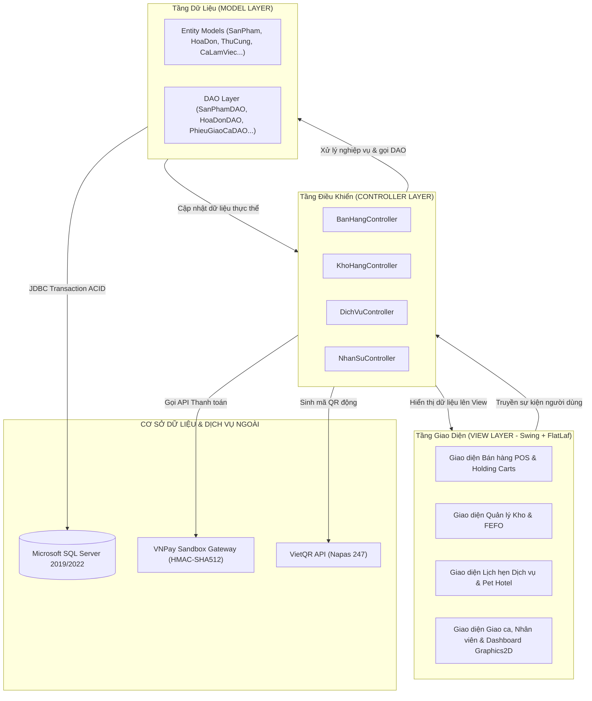

# 🐾 HỆ THỐNG QUẢN LÝ CỬA HÀNG THÚ CƯNG (PET SHOP MANAGEMENT SYSTEM)

[](https://www.oracle.com/java/)
[](https://www.microsoft.com/sql-server)
[](https://www.formdev.com/flatlaf/)
[](#-kien-truc-he-thong-mvc-pure-java)
[](https://fit.iuh.edu.vn/)

---

## 📌 THÔNG TIN ĐỒ ÁN HỌC PHẦN
- **Tên học phần:** Phát triển Ứng dụng (Application Development)
- **Đơn vị đào tạo:** Khoa Công nghệ Thông tin - Trường Đại học Công nghiệp TP. Hồ Chí Minh (IUH)
- **Đề tài:** Xây dựng Hệ thống Quản lý Cửa hàng Thú cưng (Pet Shop Management System)
- **Nhóm thực hiện:** Nhóm 07 (N07)
- **Năm học / Học kỳ:** Học kỳ 1 (2026 - 2027)

---

## 📖 MỤC LỤC
1. [Giới thiệu Dự án](#-gioi-thieu-du-an)
2. [Thành viên Nhóm & Phân công Nhiệm vụ](#-thanh-vien-nhom--phan-cong-nhiem-vu)
3. [Công nghệ Sử dụng](#-cong-nghe-su-dung)
4. [Kiến trúc Hệ thống (MVC Pure Java)](#-kien-truc-he-thong-mvc-pure-java)
5. [Các Phân Hệ Chức Năng Chính](#-cac-phan-he-chuc-nang-chinh)
6. [Cấu Trúc Thư Mục Dự Án](#-cau-truc-thu-muc-du-an)
7. [Hướng Dẫn Cài Đặt & Khởi Chạy](#-huong-dan-cai-dat--khoi-chay)
8. [Tài Khoản Đăng Nhập Mẫu (RBAC)](#-tai-khoan-dang-nhap-mau-rbac)
9. [Quy Quy Ước Phát Triển Git (Git Flow)](#-quy-uoc-phat-trien-git-git-flow)

---

## 📝 GIỚI THIỆU DỰ ÁN

Hệ thống Quản lý Cửa hàng Thú cưng là giải pháp phần mềm máy tính (Desktop Application) toàn diện, phục vụ tối ưu công tác vận hành kinh doanh bán lẻ và cung cấp dịch vụ thú cưng. Hệ thống giải quyết trọn vẹn chu trình nghiệp vụ bao gồm:

- Quầy bán hàng và thanh toán nhanh (POS) tích hợp thanh toán không dùng tiền mặt (VietQR và Cổng thanh toán VNPay Sandbox).
- Quản lý kho hàng chuyên sâu theo cơ chế **FEFO (First-Expired, First-Out)** và bảng quy đổi đơn vị tính đa cấp linh hoạt.
- Quản lý hồ sơ bệnh án, sổ theo dõi sức khỏe thú cưng, điều phối lịch hẹn Spa và phòng khách sạn lưu trú (Pet Hotel).
- Quản lý nhân sự, ma trận xếp ca làm việc tuần, quy trình bàn giao ca thu ngân đối soát tiền mặt nghiêm ngặt và dashboard phân tích dữ liệu trực quan.

---

## 👥 THÀNH VIÊN NHÓM & PHÂN CÔNG NHIỆM VỤ

| STT | Họ và Tên | Vai trò | Phân hệ nghiệp vụ phụ trách | Nhánh Git (Feature Branch) |
| :---: | :--- | :---: | :--- | :--- |
| **1** | **Tô Thanh Đạt** | **Thành viên** | **Kho hàng & Lô hàng FEFO:** Quản lý danh mục sản phẩm, kiểm soát hạn sử dụng lô hàng (FEFO), cảnh báo date 3 cấp độ, bảng quy đổi đơn vị tính đa cấp (Thùng - Khay - Lon). | `feature/kho-san-pham-lo-hang` |
| **2** | **Võ Thị Hồng Ngọc** | **Thành viên** | **Hồ sơ Thú cưng & Dịch vụ Hotel:** Quản lý hồ sơ thú cưng, số microchip, sổ theo dõi sức khỏe và lịch tiêm ngừa, điều phối lịch hẹn Spa theo khung giờ, check-in/check-out Pet Hotel. | `feature/thu-cung-dich-vu-hotel` |
| **3** | **Lê Anh Minh** | **Thành viên** | **Nhân sự, Giao ca & Báo biểu:** Đăng nhập & phân quyền RBAC 4 vai trò, ma trận xếp ca tuần, biên bản bàn giao ca thu ngân đối soát doanh thu thực tế vs sổ sách, Dashboard thống kê Graphics2D. | `feature/nhan-su-giao-ca-dashboard` |
| **4** | **Lê Khãi Minh** | **Trưởng nhóm** | **Bán hàng POS & Đổi trả:** Giao diện POS cảm ứng, đơn hàng chờ (Holding Carts), in hóa đơn, đổi trả hàng hóa, tích hợp VietQR Napas 247 & Cổng VNPay Sandbox API 2.1.0 (Local Loopback). | `feature/pos-ban-hang-doi-tra` |

---

## 💻 CÔNG NGHỆ SỬ DỤNG

- **Ngôn ngữ phát triển:** Java Standard Edition (JDK 17 LTS / JDK 21 LTS).
- **Mô hình kiến trúc:** Pure Java MVC (Model - View - Controller), độc lập, tường minh, không sử dụng Framework nặng, bám sát kiến thức nền tảng phát triển ứng dụng Java.
- **Thư viện giao diện:** Java Swing kết hợp `FlatLaf 3.5.4` (FlatLight, FlatDark UI, tùy biến bo góc, chuẩn màu thương hiệu hiện đại).
- **Hệ quản trị CSDL:** Microsoft SQL Server (2019 / 2022 / Express Edition).
- **Kết nối dữ liệu:** JDBC (`mssql-jdbc-12.8.1.jre11.jar`), quản lý giao dịch tường minh qua ACID Transaction (`setAutoCommit(false)`, `commit()`, `rollback()`).
- **Đồ họa & Trực quan hóa:** Java Graphics2D Vector (vẽ biểu đồ cột BarChart, biểu đồ tròn DonutChart độc lập không phụ thuộc thư viện thứ ba).
- **Cổng thanh toán & Tích hợp số:**
  - Chuẩn VietQR tĩnh và động (Napas 247 Dynamic QR Code chuẩn EMVCo).
  - Cổng thanh toán VNPay Sandbox v2.1.0 với bảo mật chữ ký HMAC-SHA512 và Local HTTP Server đón nhận phản hồi thanh toán tự động (Instant Payment Notification).

---

## 🏛️ KIẾN TRÚC HỆ THỐNG (MVC PURE JAVA)



---

## 🎯 CÁC PHÂN HỆ CHỨC NĂNG CHÍNH

### 1. Phân hệ Bán hàng POS & Đổi trả (Lê Khãi Minh)
- **Quầy thanh toán cảm ứng:** Tìm kiếm siêu tốc qua Barcode Scanner, mã SKU hoặc tên sản phẩm; tự động tính tổng tiền, thuế VAT và chiết khấu VIP.
- **Giỏ hàng chờ (Holding Carts):** Cho phép lưu tạm tối đa 10 hóa đơn chờ khi khách cần chọn thêm đồ hoặc đang chờ thú cưng hoàn tất dịch vụ, khôi phục đơn hàng chỉ với 1 thao tác.
- **Tích hợp thanh toán số VietQR:** Sinh QR Code động nhúng đúng số tiền đơn hàng, chống sai sót số tiền chuyển khoản.
- **Tích hợp Cổng thanh toán VNPay Sandbox:** Khởi tạo giao dịch chuẩn API v2.1.0; Local Loopback Server tự động tiếp nhận kết quả thành công và in hóa đơn mà không cần xác nhận thủ công.
- **Đổi trả hàng hóa (Return & Exchange):** Tra cứu hóa đơn cũ, hỗ trợ hoàn tiền hàng hỏng hoặc đổi sang sản phẩm mới, tự động cân đối chênh lệch tiền và điều chỉnh tồn kho / điểm tích lũy.

### 2. Phân hệ Quản lý Kho, Sản phẩm & Lô hàng FEFO (Tô Thanh Đạt)
- **Quản lý danh mục & hàng hóa:** Phân loại theo ngành hàng (Thức ăn, Phụ kiện, Thuốc thú y, Hóa mỹ phẩm).
- **Kiểm soát hạn dùng theo chuẩn FEFO (First-Expired, First-Out):** Quản lý chi tiết từng lô nhập (Số lô, ngày sản xuất, hạn sử dụng). Hệ thống tự động ưu tiên xuất bán các lô cận hạn trước để triệt tiêu hao hụt hàng hóa.
- **Cảnh báo hạn sử dụng 3 cấp độ:** Hiển thị trực quan bằng màu sắc (Xanh: An toàn $> 90$ ngày; Vàng cam: Cận date $30 - 90$ ngày; Đỏ: Nguy cơ $< 30$ ngày).
- **Quy đổi đơn vị tính đa cấp:** Khai báo quy đổi tự do (VD: `1 Thùng = 12 Khay = 48 Lon`), xuất bán theo mọi đơn vị nhưng quản lý tồn kho chính xác theo đơn vị cơ bản.

### 3. Phân hệ Hồ sơ Thú cưng, Lịch hẹn Spa & Pet Hotel (Võ Thị Hồng Ngọc)
- **Hồ sơ định danh thú cưng:** Lưu trữ thông tin chủng loài, ngày sinh, số microchip định danh, hình ảnh, tiền sử dị ứng và thông tin chủ nuôi.
- **Sổ theo dõi sức khỏe điện tử:** Ghi nhận định kỳ cân nặng, nhiệt độ cơ thể, tình trạng da lông, ve rận và nhắc hẹn lịch tiêm vắc xin/dại.
- **Điều phối lịch hẹn Dịch vụ / Spa:** Tiếp nhận lịch hẹn theo khung giờ (Time-slots), tự động phân bảng giá theo nhóm cân nặng thú cưng (Nhỏ `< 5kg`, Vừa `5 - 10kg`, Lớn `> 10kg`).
- **Khách sạn thú cưng (Pet Hotel):** Quản lý phòng lưu trú, nhật ký chăm sóc khẩu phần ăn uống, check-in, check-out và tính phí lưu trú tự động.

### 4. Phân hệ Nhân sự, Bàn giao ca & Báo biểu (Lê Anh Minh)
- **Xác thực & Phân quyền RBAC 4 vai trò:** Quản lý Cửa Hàng (NVQL), Thu Ngân (NVTN), Nhân Viên Bán Hàng (NVBH), Kỹ Thuật Viên Spa (NVCS).
- **Lập lịch & Xếp ca tuần:** Ma trận phân bổ nhân sự 4 ca làm việc trong ngày (Ca Sáng, Ca Chiều, Ca Tối, Ca Gãy).
- **Biên bản bàn giao ca thu ngân:** Khai báo tiền đầu ca, tổng hợp doanh thu tiền mặt, chuyển khoản, VNPay trong ca; đối soát tiền mặt thực tế vs số liệu máy tính và lập biên bản chênh lệch quỹ.
- **Dashboard phân tích trực quan thuần Graphics2D:** Biểu đồ doanh số theo ngày, tỷ trọng cơ cấu dịch vụ và bảng xếp hạng sản phẩm bán chạy nhất.

---

## 📂 CẤU TRÚC THƯ MỤC DỰ ÁN

```
Repo_Group07-HeThongQuanLyCuaHangThuCung/
├── .classpath                          # Cấu hình Classpath IDE Eclipse
├── .project                            # Cấu hình Project IDE Eclipse
├── .gitignore                          # Cấu hình loại trừ file của Git
├── README.md                           # Tài liệu tổng quan dự án
├── KE_HOACH_PHAN_CHIA_VA_PUSH_CODE.md  # Kế hoạch phân chia mã nguồn & lộ trình tích hợp theo đợt
├── HUONG_DAN_PUSH_CODE_THANH_VIEN.md   # Sổ tay hướng dẫn cấu hình Git, commit & PR cho thành viên
│
├── config/                             # File cấu hình tham số hệ thống
│   ├── database.properties             # Cấu hình kết nối SQL Server (host, port, user, pass)
│   ├── vietqr.properties               # Cấu hình tài khoản ngân hàng nhận VietQR
│   └── vnpay.properties                # Cấu hình Merchant Terminal Cổng VNPay Sandbox
│
├── sql/                                # Kịch bản cơ sở dữ liệu Microsoft SQL Server
│   └── DB_HeThongQuanLyThuCung.sql     # Tệp SQL duy nhất: Khởi tạo toàn bộ CSDL và nạp sẵn dữ liệu mẫu
│
├── lib/                                # Các thư viện ngoại vi (.jar)
│   ├── flatlaf-3.5.4.jar               # Giao diện phẳng FlatLaf hiện đại
│   └── mssql-jdbc-12.8.1.jre11.jar     # Trình điều khiển kết nối Microsoft SQL Server
│
├── resources/                          # Tài nguyên đồ họa ứng dụng
│   ├── icons/                          # Bộ icon phẳng chuẩn kích thước
│   └── images/                         # Ảnh sản phẩm và dịch vụ minh họa
│
└── src/                                # Mã nguồn ứng dụng (Pure Java MVC)
    ├── Main.java                       # Điểm khởi động ứng dụng (Application Entry Point)
    ├── controllers/                    # Tầng điều khiển nghiệp vụ (Controller Layer)
    ├── models/
    │   ├── entity/                     # Các lớp thực thể đối tượng (Domain Models)
    │   └── dao/                        # Các lớp truy vấn dữ liệu SQL Server (Data Access Objects)
    ├── utils/                          # Lớp tiện ích (DBConnection, ThemeColors, VNPayHelper...)
    ├── views/                          # Giao diện người dùng Swing (Views, Panels, Dialogs)
    │   └── charts/                     # Thành phần biểu đồ tùy biến bằng Java Graphics2D
    └── tests/                          # Bộ mã kiểm thử tự động hệ thống
```

---

## 🚀 HƯỚNG DẪN CÀI ĐẶT & KHỞI CHẠY

### 1. Yêu cầu môi trường
- **Java Development Kit (JDK):** JDK 17 hoặc JDK 21 (Oracle JDK / OpenJDK).
- **Hệ quản trị CSDL:** Microsoft SQL Server 2019 / 2022 / Express.
- **IDE:** Eclipse IDE for Java Developers (khuyến nghị) hoặc IntelliJ IDEA.

### 2. Thiết lập Cơ sở dữ liệu SQL Server
1. Mở **SQL Server Management Studio (SSMS)** và kết nối vào SQL Server instance của bạn.
2. Mở tệp kịch bản duy nhất [`sql/DB_HeThongQuanLyThuCung.sql`](sql/DB_HeThongQuanLyThuCung.sql) và bấm **Execute** (`F5`).
   - Tệp sẽ tự động tạo cơ sở dữ liệu `QuanLyCuaHangThuCung`, khởi tạo toàn bộ 25 bảng và nạp sẵn dữ liệu mẫu kiểm thử hoàn chỉnh.
3. Mở tệp cấu hình [`config/database.properties`](config/database.properties) để kiểm tra hoặc điều chỉnh thông tin tài khoản kết nối SQL Server (nếu mật khẩu máy bạn khác `123456`):
   ```properties
   db.host=localhost
   db.port=1433
   db.databaseName=QuanLyCuaHangThuCung
   db.username=sa
   db.password=YourStrongPasswordHere
   ```

### 3. Khởi chạy bằng Eclipse IDE
1. Mở Eclipse $\rightarrow$ **File** $\rightarrow$ **Import...** $\rightarrow$ **General** $\rightarrow$ **Existing Projects into Workspace**.
2. Chọn thư mục dự án và bấm **Finish**.
3. Nhấp chuột phải vào dự án $\rightarrow$ **Build Path** $\rightarrow$ **Configure Build Path...** $\rightarrow$ Thẻ **Libraries** $\rightarrow$ Đảm bảo 2 tệp `.jar` trong thư mục `lib/` đã được thêm vào classpath.
4. Mở tệp [`src/Main.java`](src/Main.java) $\rightarrow$ Nhấp chuột phải $\rightarrow$ Chọn **Run As** $\rightarrow$ **Java Application**.

### 4. Khởi chạy bằng Command-line (Terminal)
```bash
# Biên dịch toàn bộ mã nguồn vào thư mục bin/
javac -encoding UTF-8 -cp "lib/*" -d bin src/**/*.java src/Main.java

# Khởi chạy ứng dụng
java -cp "bin;lib/*" Main
```

---

## 🔑 TÀI KHOẢN ĐĂNG NHẬP MẪU (RBAC)

Hệ thống được cấu hình sẵn 4 tài khoản mẫu đại diện cho 4 cấp độ phân quyền trong doanh nghiệp:

| Nhóm quyền hạn | Tên đăng nhập | Mật khẩu | Phạm vi quyền hạn thực thi |
| :--- | :---: | :---: | :--- |
| **Quản Lý Cửa Hàng (Admin)** | `admin` | `123456` | Toàn quyền kiểm soát hệ thống: POS, Kho hàng, Hồ sơ dịch vụ, Phân ca làm việc, Bàn giao quỹ và Dashboard thống kê. |
| **Thu Ngân (Cashier)** | `thungan01` | `123456` | Bán hàng POS, In hóa đơn, Đổi trả hàng, Khai báo đầu ca, Bàn giao ca và In báo cáo kết ca. |
| **Nhân Viên Bán Hàng (Sales)** | `banhang01` | `123456` | Quầy bán hàng POS, Tra cứu thông tin sản phẩm và tư vấn khách hàng. |
| **Kỹ Thuật Viên Spa (Care)** | `ktv01` | `123456` | Quản lý hồ sơ thú cưng, Sổ sức khỏe điện tử, Tiếp nhận đặt lịch Spa và Quản lý phòng Pet Hotel. |

---

## 🌿 QUY ƯỚC PHÁT TRIỂN GIT (GIT FLOW)

Để đảm bảo tiến độ làm việc nhóm nhịp nhàng, minh bạch và có đầy đủ lịch sử đóng góp (Contributors Graph) đồng đều giữa các thành viên, nhóm áp dụng mô hình Git Flow tiêu chuẩn:

- **Nhánh `main`:** Nhánh phát hành chính thức, bảo vệ nghiêm ngặt (Protected Branch), chỉ chứa các phiên bản ổn định phục vụ chấm điểm và bàn giao đồ án.
- **Nhánh `develop`:** Nhánh tích hợp làm việc chung của cả nhóm. Mọi tính năng sau khi kiểm thử đạt yêu cầu sẽ được merge vào đây.
- **Nhánh tính năng (Feature Branches):** Mỗi thành viên độc lập phát triển trên nhánh riêng của mình:
  - `feature/kho-san-pham-lo-hang` (Tô Thanh Đạt)
  - `feature/thu-cung-dich-vu-hotel` (Võ Thị Hồng Ngọc)
  - `feature/nhan-su-giao-ca-dashboard` (Lê Anh Minh)
  - `feature/pos-ban-hang-doi-tra` (Lê Khãi Minh)

> 📌 **Tài liệu hướng dẫn & Kế hoạch làm việc nhóm:**  
> 👉 [**KE_HOACH_PHAN_CHIA_VA_PUSH_CODE.md**](KE_HOACH_PHAN_CHIA_VA_PUSH_CODE.md): Kế hoạch phân chia mã nguồn, chi tiết 4 gói code & lộ trình tích hợp theo đợt.  
> 👉 [**HUONG_DAN_PUSH_CODE_THANH_VIEN.md**](HUONG_DAN_PUSH_CODE_THANH_VIEN.md): Hướng dẫn từng bước từ cấu hình Git, lệnh commit theo đợt đến quy trình Review & Merge Pull Request.

---

## 📜 BẢN QUYỀN & THÔNG TIN LIÊN HỆ
- **Đồ án môn học:** Phát triển Ứng dụng - Khoa Công nghệ Thông tin - Đại học Công nghiệp TP.HCM (IUH).
- **Trưởng nhóm:** Lê Khãi Minh (Email: `lekhaiminh2606@gmail.com` | GitHub: [@minhto1306](https://github.com/minhto1306)).
- **Giấy phép:** Phục vụ mục đích học tập và nghiên cứu học thuật tại Trường Đại học Công nghiệp TP.HCM.
