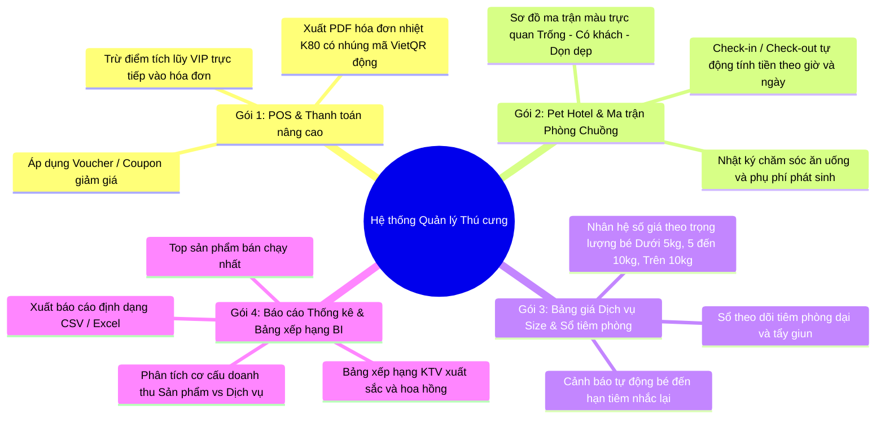
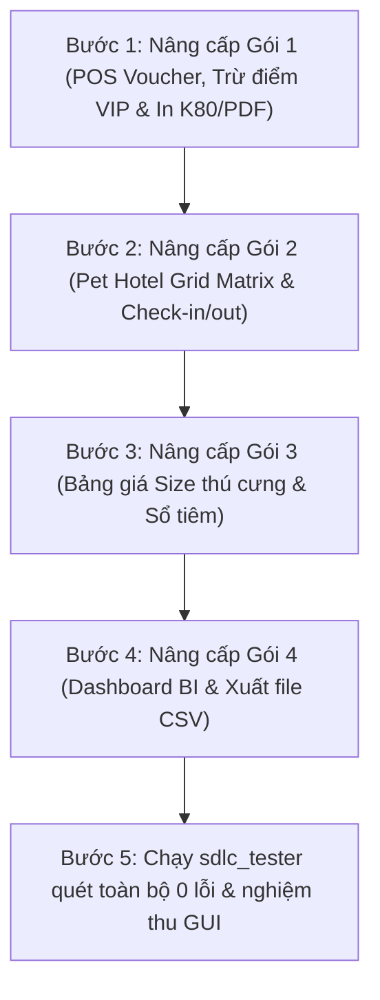

# 🐾 KẾ HOẠCH NÂNG CẤP TOÀN DIỆN HỆ THỐNG QUẢN LÝ CỬA HÀNG THÚ CƯNG
> **Mục tiêu:** Nâng cấp hệ thống từ mức độ đồ án cơ bản lên chuẩn hệ thống thương mại thực tế, mở rộng 4 gói tính năng chuyên sâu, hoàn thiện giao diện FlatLaf Light sang trọng và bảo toàn trạng thái 0 lỗi qua kiểm thử tự động.

---

## 📌 TỔNG QUAN 4 GÓI TÍNH NĂNG NÂNG CẤP

---

## 🚀 CHI TIẾT CÁC HẠNG MỤC THỰC HIỆN

### Gói 1: POS & Thanh toán Nâng cao (Voucher & In hóa đơn K80)
* **Mục tiêu nghiệp vụ:**
  1. **Voucher / Khuyến mãi:** Hỗ trợ nhập mã Voucher giảm theo số tiền cố định (vd: `PET50K` giảm 50.000đ) hoặc theo phần trăm (vd: `VIP10` giảm 10% tối đa 100.000đ).
  2. **Quy đổi Điểm thưởng VIP:** 1 điểm = 1.000 VNĐ. Khách hàng VIP có thể chọn trừ điểm trực tiếp vào tiền phải thanh toán.
  3. **In hóa đơn nhiệt K80 / Xem trước:** Hộp thoại [HoaDonPreviewDialog.java](file:///C:/Users/lekha/eclipse-workspace/N07-HeThongQuanLyCuaHangThuCungMio/src/views/HoaDonPreviewDialog.java) định dạng chuẩn hóa đơn bán lẻ 80mm, nhúng mã VietQR Napas 247 động, cho phép xuất file `.pdf` hoặc in trực tiếp.
* **Các file can thiệp:**
  - [BanHangPOSPanel.java](file:///C:/Users/lekha/eclipse-workspace/N07-HeThongQuanLyCuaHangThuCungMio/src/views/BanHangPOSPanel.java)
  - [HoaDonPreviewDialog.java](file:///C:/Users/lekha/eclipse-workspace/N07-HeThongQuanLyCuaHangThuCungMio/src/views/HoaDonPreviewDialog.java)
  - [HoaDon.java](file:///C:/Users/lekha/eclipse-workspace/N07-HeThongQuanLyCuaHangThuCungMio/src/models/entity/HoaDon.java)

---

### Gói 2: Khách sạn Thú cưng (Pet Hotel Room Grid Matrix)
* **Mục tiêu nghiệp vụ:**
  1. **Sơ đồ phòng trực quan:** Hiển thị 3 dãy phòng: Tiêu chuẩn (Standard), VIP Suite, và Condo mèo. Màu sắc Happy Hues:
     - 🟩 **Xanh lá nhạt (`#c3f0ca`):** Phòng trống, sẵn sàng đón khách.
     - 🟥 **Hồng nhạt (`#ffc6c7`):** Đang có thú cưng lưu trú (hiển thị ảnh, tên bé, số phòng, số ngày).
     - 🟨 **Vàng nhạt (`#fef3c7`):** Đang dọn dẹp, khử trùng.
  2. **Check-in & Check-out 1-chạm:** 
     - Check-in: Chọn thú cưng, ngày dự kiến đón, ghi chú đặc biệt (loại hạt, tật sợ sấm...).
     - Check-out: Tự động tính tổng tiền lưu trú theo số ngày thực tế + phụ phí ăn uống/tắm rửa, chuyển thẳng giỏ hàng sang POS để thanh toán.
* **Các file can thiệp:**
  - [PetHotelPanel.java](file:///C:/Users/lekha/eclipse-workspace/N07-HeThongQuanLyCuaHangThuCungMio/src/views/PetHotelPanel.java)
  - [models/dao/PhongLuuTruDAO.java](file:///C:/Users/lekha/eclipse-workspace/N07-HeThongQuanLyCuaHangThuCungMio/src/models/dao)

---

### Gói 3: Bảng giá theo Cân nặng & Sổ Tiêm phòng Sức khỏe
* **Mục tiêu nghiệp vụ:**
  1. **Hệ số giá dịch vụ động:**
     - Bé nhỏ ($< 5\text{ kg}$): Hệ số $\times 1.0$ (Giá gốc).
     - Bé vừa ($5 - 10\text{ kg}$): Hệ số $\times 1.2$ (+20%).
     - Bé lớn ($> 10\text{ kg}$): Hệ số $\times 1.5$ (+50%).
     - Tự động gợi ý mức giá khi thu ngân chọn thú cưng trong Dialog chọn dịch vụ.
  2. **Sổ tiêm chủng & Cảnh báo sức khỏe:**
     - Quản lý lịch tiêm phòng dại, vắc-xin 7 bệnh, lịch tẩy giun định kỳ.
     - Đánh dấu trạng thái: Đã tiêm (Xanh), Sắp đến hạn (Cam), Quá hạn (Đỏ nguy cấp).
* **Các file can thiệp:**
  - [ChonDichVuDialog.java](file:///C:/Users/lekha/eclipse-workspace/N07-HeThongQuanLyCuaHangThuCungMio/src/views/ChonDichVuDialog.java)
  - [ThuCungDichVuPanel.java](file:///C:/Users/lekha/eclipse-workspace/N07-HeThongQuanLyCuaHangThuCungMio/src/views/ThuCungDichVuPanel.java)
  - [HoSoSucKhoe.java](file:///C:/Users/lekha/eclipse-workspace/N07-HeThongQuanLyCuaHangThuCungMio/src/models/entity/HoSoSucKhoe.java)

---

### Gói 4: Báo cáo Thống kê BI & Bảng Xếp Hạng KTV (Export CSV)
* **Mục tiêu nghiệp vụ:**
  1. **Biểu đồ cơ cấu doanh thu:** Trực quan hóa tỷ trọng Doanh thu Sản phẩm vs Doanh thu Dịch vụ (Donut Chart bằng Graphics2D).
  2. **Bảng xếp hạng KTV xuất sắc:** Thống kê số lượng dịch vụ đã hoàn tất và tổng tiền hoa hồng nhận được trong tháng.
  3. **Top 5 Sản phẩm bán chạy nhất:** Thống kê sản phẩm có sản lượng tiêu thụ cao nhất.
  4. **Xuất báo cáo Excel / CSV:** Cho phép tải file báo cáo định dạng CSV chuẩn UTF-8 có thể mở ngay bằng Microsoft Excel.
* **Các file can thiệp:**
  - [BaoCaoThongKeDialog.java](file:///C:/Users/lekha/eclipse-workspace/N07-HeThongQuanLyCuaHangThuCungMio/src/views/BaoCaoThongKeDialog.java)
  - [TongQuanPanel.java](file:///C:/Users/lekha/eclipse-workspace/N07-HeThongQuanLyCuaHangThuCungMio/src/views/TongQuanPanel.java)
  - [views/charts/](file:///C:/Users/lekha/eclipse-workspace/N07-HeThongQuanLyCuaHangThuCungMio/src/views/charts)

---

## 📅 LỘ TRÌNH THỰC HIỆN TỪNG BƯỚC (SDLC CYCLE)

---

## 🛡️ TIÊU CHUẨN THIẾT KẾ GIAO DIỆN & CODE QUALITY
1. **Giao diện FlatLaf Light:**
   - Bo góc mềm mại (Round corners 8px-12px), nút bấm có hiệu ứng hover mượt mà.
   - Bảng màu hài hòa theo [ThemeColors.java](file:///C:/Users/lekha/eclipse-workspace/N07-HeThongQuanLyCuaHangThuCungMio/src/utils/ThemeColors.java): Soft Apricot / Nude Warm Peach / Deep Navy.
   - Typography: Segoe UI mượt mà, khử răng cưa toàn diện (Anti-Aliasing).
2. **Quy chuẩn Code Ponytail:**
   - Sửa đúng nơi, tích hợp liền mạch vào các component có sẵn, không đập đi xây lại cấu trúc.
   - Đảm bảo 100% biên dịch thành công và các bài test tự động đều pass.

---

## 🏆 KẾT QUẢ TRIỂN KHAI 3 MÔ HÌNH THỰC TẾ (1, 3, 5)

### 1. Mô hình 1: Thẻ Gói Dịch Vụ Spa Định Kỳ (Spa Pass / Punch Card)
- **Thực thể & Controller:** Đã tạo [TheSpaPass.java](file:///C:/Users/lekha/eclipse-workspace/N07-HeThongQuanLyCuaHangThuCungMio/src/models/entity/TheSpaPass.java) và [SpaPassController.java](file:///C:/Users/lekha/eclipse-workspace/N07-HeThongQuanLyCuaHangThuCungMio/src/controllers/SpaPassController.java).
- **Giao diện POS quầy:** Tích hợp Dòng 4 trong Panel Khách hàng [BanHangPOSPanel.java](file:///C:/Users/lekha/eclipse-workspace/N07-HeThongQuanLyCuaHangThuCungMio/src/views/BanHangPOSPanel.java) hiển thị trạng thái thẻ, số buổi còn lại và nút bấm `[Dùng 1 buổi Spa]`.
- **Nghiệp vụ Punch Card:** Khi bấm dùng, hệ thống thêm dịch vụ 0 đ vào giỏ và tự động trừ 1 buổi khả dụng trên thẻ khi thanh toán. Hỗ trợ Family Sharing qua SĐT cho nhiều bé trong cùng gia đình.
- **Kiểm thử tự động:** [TestMoHinh1SpaPass.java](file:///C:/Users/lekha/eclipse-workspace/N07-HeThongQuanLyCuaHangThuCungMio/src/tests/TestMoHinh1SpaPass.java): **3/3 PASS (100%)**.

### 2. Mô hình 3: Cảnh báo Dị ứng Thực phẩm & Gợi ý Bán kèm Thông minh (Allergy Guard & Smart Cross-Sell)
- **Allergy Guard:** Tự động phát hiện tiền sử dị ứng theo hồ sơ thú cưng (`Bé Bim Bim` -> `DỊ ỨNG ĐẠM GÀ`; `Bé Miu Miu` -> `DỊ ỨNG LACTOSE`).
- **Cơ chế Cảnh báo Khuyên dùng (Advisory Warning):** Không chặn cứng cửa hàng. Khi thu ngân thêm sản phẩm chứa thành phần dị ứng, hiển thị thông báo với 2 lựa chọn: `Đổi sang món khác (Khuyên dùng)` hoặc `Khách xác nhận tự chọn mua`. Khách vãng lai chưa có hồ sơ không bị cảnh báo gián đoạn.
- **Smart Cross-Sell:** Banner gợi ý màu vàng nhạt tích hợp phía dưới bảng giỏ hàng. Khi giỏ có dịch vụ Spa Grooming -> Gợi ý Xịt trị ve rận Bio-Care giảm 10% (67.500 đ); khi giỏ có thức ăn hạt -> Gợi ý Pate dinh dưỡng phù hợp hồ sơ dị ứng giảm 10% (18.000 đ). Bấm `[+ Thêm (-10%)]` sẽ nạp thẳng vào giỏ hàng.
- **Kiểm thử tự động:** [TestMoHinh3AllergyCrossSell.java](file:///C:/Users/lekha/eclipse-workspace/N07-HeThongQuanLyCuaHangThuCungMio/src/tests/TestMoHinh3AllergyCrossSell.java): **3/3 PASS (100%)**.

### 3. Mô hình 5: Điểm Tái Đặt Hàng (ROP) & Đề Xuất Nhập Kho Dự Phòng (FEFO Clearance)
- **Tab 3 Kho Hàng:** Đã thêm tab `  Điểm Tái Đặt Hàng (ROP) & Đề Xuất Nhập Kho` trong [KhoLoHangPanel.java](file:///C:/Users/lekha/eclipse-workspace/N07-HeThongQuanLyCuaHangThuCungMio/src/views/KhoLoHangPanel.java).
- **Công thức tính toán:** $ROP = (d \times L) + SS$. Hiển thị cột số liệu chi tiết: Tiêu thụ TB/ngày ($d$), Lead Time ($L$), Tồn an toàn ($SS$), Điểm ROP, và Trạng thái khuyến nghị (Badge màu sắc nét).
- **Quy tắc FEFO Ưu tiên Xả Hàng:** Nếu sản phẩm có lô hàng cận date ($\le 30$ ngày), hệ thống hiển thị badge màu vàng cam `FEFO: CẬN DATE (Ưu tiên xả hàng)` và chặn đề xuất đặt hàng mới ($Q = 0$) để tránh ứ đọng vốn và hư hỏng hàng hóa.
- **Tạo Đơn Đề Xuất Nhập Hàng (Draft PO) & Xuất CSV:** Nút `[Tạo Đơn Đề Xuất Nhập Hàng (Draft PO)]` hiển thị popup bảng các mặt hàng cần nhập bù 14 ngày bán ($Q > 0$) và xuất file `export/DeXuatNhapHang_ROP_<timestamp>.txt`. Nút `[Xuất Báo Cáo ROP (.csv)]` xuất file CSV chuẩn UTF-8 BOM hiển thị tiếng Việt hoàn hảo trên Excel.
- **Kiểm thử tự động:** [TestMoHinh5DiemDatHangROP.java](file:///C:/Users/lekha/eclipse-workspace/N07-HeThongQuanLyCuaHangThuCungMio/src/tests/TestMoHinh5DiemDatHangROP.java): **3/3 PASS (100%)**.

---

## 📊 TỔNG HỢP KẾT QUẢ REGRESSION TESTING
- `TestMoHinh1SpaPass`: **3/3 PASS (100%)**
- `TestMoHinh3AllergyCrossSell`: **3/3 PASS (100%)**
- `TestMoHinh5DiemDatHangROP`: **3/3 PASS (100%)**
- `TestGoi1PosVoucher`: **3/3 PASS (100%)**
- `TestGoi2PetHotel`: **3/3 PASS (100%)**
- `TestGoi3DichVuCanNangSoTiem`: **3/3 PASS (100%)**
- `TestGoi4BaoCaoThongKeBI`: **3/3 PASS (100%)**
- `VerifyModulesTest`: **8/8 PASS (100%)**
- `PureGuiPrototypeTest`: **13/13 PASS (100%)**
- **Tổng số lỗi biên dịch:** **0 LỖI (Zero Compiler Errors)**.
