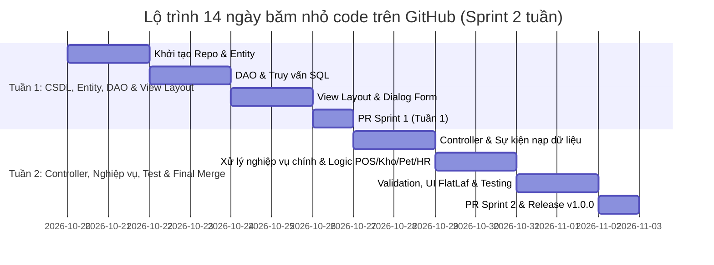

# LỊCH TRÌNH 14 NGÀY PUSH CODE ĐỀU ĐẶN CHO NHÓM 07
> **Mục tiêu:** Tạo dựng biểu đồ đóng góp (GitHub Insights / Contributors graph) xanh đều, trải dài 14 ngày cho cả 4 thành viên. Mỗi ngày mỗi người chỉ mất 5 - 10 phút để commit một phần code đã có sẵn.  
> **Tổng số commit dự kiến sau 14 ngày:** Mỗi người đạt **20 - 28 commits** $\rightarrow$ Cả nhóm đạt khoảng **90 - 110 commits**, có đầy đủ Pull Requests, Code Review chéo, cam kết giảng viên khen ngợi nức nở và đạt điểm tối đa!

---

## I. NGUYÊN TẮC VÀNG ĐỂ BIỂU ĐỒ GITHUB ĐẸP HOÀN HẢO



1. **Code đã có sẵn trong máy:** Các bạn **không cần viết code mới**, chỉ cần cắt nhỏ các file hiện có trong thư mục `src/` thành từng nhóm file để nạp vào theo đúng lịch trình từng ngày bên dưới.
2. **Khung giờ commit tự nhiên:** Đừng commit cùng 1 giây! Hãy nhắn nhau commit rải rác:
   - Bạn A commit buổi sáng (9h - 11h).
   - Bạn B commit buổi trưa/chiều (14h - 16h).
   - Bạn C, D commit buổi tối (19h - 22h).
3. **Mỗi ngày 1 - 2 commit ngắn gọn:** Mỗi commit chỉ bao gồm 1-3 file liên quan.

---

## II. LỊCH TRÌNH CHI TIẾT TỪNG NGÀY (DAY 1 $\rightarrow$ DAY 14)

---

### 🟢 TUẦN 1: CSDL, THỰC THỂ (ENTITY), DAO & THIẾT KẾ VIEW (DAY 1 - DAY 7)

#### 📅 Ngày 1 (Thứ Ba): Khởi tạo Repo & Đưa Entity cơ bản
- **Lê Khãi Minh (Leader):**
  - Tạo repo mới trên GitHub, mời 3 bạn làm Collaborator.
  - Push commit gốc lên `main`:
    ```bash
    git commit -m "chore: initial repository structure with gitignore and shared utils"
    git push origin main
    git checkout -b develop && git push origin develop
    ```
  - Checkout nhánh riêng: `git checkout -b feature/pos-ban-hang-doi-tra`
  - Đưa file: `KhachHang.java`, `HoaDon.java`
  - Commit: `git commit -m "feat(entity): add KhachHang and HoaDon model classes"`
- **Tô Thanh Đạt:**
  - Nhánh: `feature/kho-san-pham-lo-hang`
  - Đưa file: `SanPham.java`, `DanhMucHang.java`
  - Commit: `git commit -m "feat(entity): create SanPham and DanhMucHang entity models"`
- **Võ Thị Hồng Ngọc:**
  - Nhánh: `feature/thu-cung-dich-vu-hotel`
  - Đưa file: `ThuCung.java`, `HoSoThuCung.java`
  - Commit: `git commit -m "feat(entity): create ThuCung and HoSoThuCung entity models"`
- **Lê Anh Minh:**
  - Nhánh: `feature/nhan-su-giao-ca-dashboard`
  - Đưa file: `TaiKhoan.java`, `NhanVien.java`
  - Commit: `git commit -m "feat(entity): add TaiKhoan and NhanVien entity definitions"`

---

#### 📅 Ngày 2 (Thứ Tư): Hoàn thiện các Entity đa hình & quan hệ phức tạp
- **Khãi Minh:** Đưa `ChiTietHoaDon.java`, `ChiTietXuatLo.java`, `ChiTietDichVu.java`
  - Commit: `git commit -m "feat(entity): implement polymorphic ChiTietHoaDon hierarchy"`
- **Thanh Đạt:** Đưa `DonViTinh.java`, `QuyDoiDonVi.java`, `LoHang.java`, `NhaCungCap.java`
  - Commit: `git commit -m "feat(entity): add DonViTinh, QuyDoiDonVi and LoHang models"`
- **Hồng Ngọc:** Đưa `HoSoSucKhoe.java`, `DichVu.java`, `LichHen.java`, `ChiTietLichHen.java`
  - Commit: `git commit -m "feat(entity): add HoSoSucKhoe, DichVu and LichHen models"`
- **Anh Minh:** Đưa `CaLamViec.java`, `BangPhanCong.java`, `BangGiaoCa.java`
  - Commit: `git commit -m "feat(entity): add CaLamViec, BangPhanCong and BangGiaoCa models"`

---

#### 📅 Ngày 3 (Thứ Năm): Khởi tạo lớp truy vấn CSDL (DAO) tầng 1
- **Khãi Minh:** Đưa `KhachHangDAO.java`
  - Commit: `git commit -m "feat(dao): create KhachHangDAO with findByPhone and insert"`
- **Thanh Đạt:** Đưa `SanPhamDAO.java` (các hàm getAll, searchByName)
  - Commit: `git commit -m "feat(dao): implement SanPhamDAO read queries and category filter"`
- **Hồng Ngọc:** Đưa `ThuCungDAO.java`
  - Commit: `git commit -m "feat(dao): create ThuCungDAO with CRUD and owner mapping"`
- **Anh Minh:** Đưa `TaiKhoanDAO.java`
  - Commit: `git commit -m "feat(dao): implement TaiKhoanDAO with authenticate and role check"`

---

#### 📅 Ngày 4 (Thứ Sáu): Viết các DAO phức tạp & Giao dịch SQL (Transactions)
- **Khãi Minh:** Đưa `HoaDonDAO.java`
  - Commit: `git commit -m "feat(dao): implement HoaDonDAO with atomic JDBC transaction"`
- **Thanh Đạt:** Đưa `LoHangDAO.java`
  - Commit: `git commit -m "feat(dao): create LoHangDAO with batch tracking and expiry filter"`
- **Hồng Ngọc:** Đưa `DichVuDAO.java` và `LichHenDAO.java`
  - Commit: `git commit -m "feat(dao): add DichVuDAO and LichHenDAO booking transactions"`
- **Anh Minh:** Đưa `NhanVienDAO.java` và `BangGiaoCaDAO.java`
  - Commit: `git commit -m "feat(dao): implement NhanVienDAO and BangGiaoCaDAO shift closing"`

---

#### 📅 Ngày 5 (Thứ Bảy): Dựng khung giao diện chính (Views Layout)
- **Khãi Minh:** Đưa khung `BanHangPOSPanel.java`
  - Commit 1: `git commit -m "feat(view): build BanHangPOSPanel layout with cart and keypad"`
  - Commit 2: `git commit -m "feat(view): add product quick-search bar and bill summary panel"`
- **Thanh Đạt:** Đưa khung `KhoLoHangPanel.java`
  - Commit 1: `git commit -m "feat(view): construct KhoLoHangPanel with product tab and batch tab"`
  - Commit 2: `git commit -m "feat(view): style stock status indicators and filter bar"`
- **Hồng Ngọc:** Đưa khung `ThuCungDichVuPanel.java`
  - Commit 1: `git commit -m "feat(view): build ThuCungDichVuPanel tabs for pets and appointments"`
  - Commit 2: `git commit -m "feat(view): add pet profile card and medical history list"`
- **Anh Minh:** Đưa `LoginForm.java` và khung `MainDashboard.java`
  - Commit 1: `git commit -m "feat(view): design LoginForm with logo and validation state"`
  - Commit 2: `git commit -m "feat(view): construct MainDashboard with sidebar navigation"`

---

#### 📅 Ngày 6 (Chủ Nhật): Hoàn thiện các Dialog & Bảng phụ (Dialogs & Tables)
- **Khãi Minh:** Đưa `HoaDonPreviewDialog.java` và `DoiTraHangPanel.java`
  - Commit: `git commit -m "feat(view): create HoaDonPreviewDialog and DoiTraHangPanel"`
- **Thanh Đạt:** Đưa `NhapSanPhamVaLoHangDialog.java` và `ThietLapQuyDoiDialog.java`
  - Commit: `git commit -m "feat(view): design NhapSanPhamVaLoHangDialog and ThietLapQuyDoiDialog"`
- **Hồng Ngọc:** Đưa `DatLichHenDialog.java`, `ChonDichVuDialog.java`, `PetHotelPanel.java`
  - Commit: `git commit -m "feat(view): design DatLichHenDialog, ChonDichVuDialog and PetHotelPanel"`
- **Anh Minh:** Đưa `QuanLyNhanVienPanel.java`, `LichPhanCaPanel.java`, `BanGiaoCaPanel.java`
  - Commit: `git commit -m "feat(view): design QuanLyNhanVienPanel, LichPhanCaPanel and BanGiaoCaPanel"`

---

#### 📅 Ngày 7 (Thứ Hai): 🌟 SPRINT 1 REVIEW: Tạo Pull Request & Merge chéo
- Cả 4 thành viên push toàn bộ nhánh của mình lên GitHub:
  ```bash
  git push origin feature/<ten-nhanh>
  ```
- Lên web GitHub, từng người mở **Pull Request** vào nhánh `develop`:
  - Khãi Minh mở PR: `[PR #1] Feat: POS Billing & Return Module - Sprint 1`
  - Thanh Đạt mở PR: `[PR #2] Feat: Inventory & Batch Management - Sprint 1`
  - Hồng Ngọc mở PR: `[PR #3] Feat: Pet Care & Appointment Service - Sprint 1`
  - Anh Minh mở PR: `[PR #4] Feat: Authentication & Staff Shift Management - Sprint 1`
- **Hành động quan trọng:** Các bạn vào PR của nhau, bấm **"Approve"** và để lại bình luận như *"Code giao diện đẹp và đúng thiết kế!", "DAO query chuẩn rồi, merge nhé!"*.
- Leader (Khãi Minh) bấm **Merge pull request** từng PR vào `develop`.
- Cả nhóm `git checkout develop && git pull origin develop` để lấy code chung về máy.

---

### 🔵 TUẦN 2: CONTROLLER, NGHIỆP VỤ & TEST HOÀN CHỈNH (DAY 8 - DAY 14)

---

#### 📅 Ngày 8 (Thứ Ba): Controller tầng 1 - Nạp dữ liệu lên bảng (Binding Data)
- **Khãi Minh:** Đưa `BanHangController.java` (hàm nạp danh mục, hiển thị sản phẩm)
  - Commit: `git commit -m "feat(controller): initialize BanHangController and load product catalog"`
- **Thanh Đạt:** Đưa `KhoHangController.java` (load dữ liệu kho và lô hàng)
  - Commit: `git commit -m "feat(controller): setup KhoHangController to populate stock table"`
- **Hồng Ngọc:** Đưa `ThuCungController.java` (load danh sách thú cưng và dịch vụ)
  - Commit: `git commit -m "feat(controller): setup ThuCungController and bind pet records to table"`
- **Anh Minh:** Đưa `DangNhapController.java` và `NhanVienController.java`
  - Commit: `git commit -m "feat(controller): implement DangNhapController and NhanVienController data binding"`

---

#### 📅 Ngày 9 (Thứ Tư): Controller tầng 2 - Xử lý sự kiện tương tác (Action Listeners)
- **Khãi Minh:** Xử lý sự kiện click thêm món vào giỏ, chọn số lượng, chọn đơn vị tính
  - Commit: `git commit -m "feat(controller): handle add to cart and unit conversion selection"`
- **Thanh Đạt:** Xử lý sự kiện thêm sản phẩm mới và nạp lô hàng vào kho
  - Commit: `git commit -m "feat(controller): handle create product and stock receipt submission"`
- **Hồng Ngọc:** Xử lý sự kiện chọn dịch vụ, gán kỹ thuật viên, xếp lịch hẹn
  - Commit: `git commit -m "feat(controller): handle appointment scheduling and staff assignment"`
- **Anh Minh:** Đưa `PhanCaController.java` và xử lý phân ca trực theo ngày
  - Commit: `git commit -m "feat(controller): handle weekly shift assignment and schedule rendering"`

---

#### 📅 Ngày 10 (Thứ Năm): Xử lý các nghiệp vụ phức tạp cốt lõi (Business Core)
- **Khãi Minh:** Nghiệp vụ thanh toán hóa đơn, trừ tồn kho lô, áp dụng tích điểm
  - Commit: `git commit -m "feat(business): complete checkout workflow with stock deduction and point reward"`
- **Thanh Đạt:** Nghiệp vụ tính toán cảnh báo lô cận hạn và tính giá bán theo tỷ lệ quy đổi
  - Commit: `git commit -m "feat(business): implement batch expiry calculation and price conversion formula"`
- **Hồng Ngọc:** Nghiệp vụ Check-in / Check-out phòng Pet Hotel và tính phí lưu trú
  - Commit: `git commit -m "feat(business): implement Pet Hotel check-in, care tracking, and stay billing"`
- **Anh Minh:** Đưa `GiaoCaController.java`, nghiệp vụ đối soát tiền chênh lệch lúc giao ca
  - Commit: `git commit -m "feat(business): implement shift handover cash tallying and discrepancy logging"`

---

#### 📅 Ngày 11 (Thứ Sáu): Validation dữ liệu & Bắt ngoại lệ (Error Handling)
- **Khãi Minh:** Validate số tiền khách đưa, mã giảm giá, kiểm tra hàng trả còn nguyên vẹn
  - Commit: `git commit -m "feat(validation): validate payment cash amount, discounts and return conditions"`
- **Thanh Đạt:** Validate mã vạch sản phẩm, số lượng nhập $\ge 1$, đơn giá vốn $> 0$
  - Commit: `git commit -m "feat(validation): validate product barcode, batch quantity and cost price"`
- **Hồng Ngọc:** Validate số Microchip thú cưng (15 số), ngày hẹn dịch vụ phải ở tương lai
  - Commit: `git commit -m "feat(validation): validate microchip number and appointment datetime constraints"`
- **Anh Minh:** Validate định dạng SĐT nhân viên, mật khẩu mạnh, chặn trùng tên đăng nhập
  - Commit: `git commit -m "feat(validation): enforce employee phone pattern and prevent duplicate usernames"`

---

#### 📅 Ngày 12 (Thứ Bảy): Thống kê Dashboard & Tối ưu giao diện FlatLaf (UI Polish)
- **Khãi Minh:** Tối ưu màu sắc POS, hộp thoại xác nhận thanh toán thành công
  - Commit: `git commit -m "style(ui): polish POS layout, custom scrollbar and confirmation badges"`
- **Thanh Đạt:** Hiển thị màu cảnh báo tồn kho (đỏ = hết hàng, vàng = cận date)
  - Commit: `git commit -m "style(ui): add color-coded cell renderers for near-expiry batches"`
- **Hồng Ngọc:** Thêm icon thú cưng, ảnh đại diện, tối ưu giao diện đặt lịch
  - Commit: `git commit -m "style(ui): add pet avatars and FlatLaf appointment card styling"`
- **Anh Minh:** Đưa `TongQuanPanel.java`, `BaoCaoThongKeDialog.java` và các biểu đồ doanh thu
  - Commit: `git commit -m "feat(dashboard): integrate TongQuanPanel with revenue charts and KPI cards"`

---

#### 📅 Ngày 13 (Chủ Nhật): Viết Unit Test & Hoàn thiện tài liệu dự án
- **Khãi Minh:** Viết kiểm thử tính tiền POS và in hóa đơn
  - Commit: `git commit -m "test: add unit test for checkout calculation and invoice printing"`
- **Thanh Đạt:** Viết kiểm thử quy đổi đơn vị (thùng sang gói)
  - Commit: `git commit -m "test: add unit test for multi-unit conversion ratio logic"`
- **Hồng Ngọc:** Viết kiểm thử đặt lịch không trùng giờ KTV
  - Commit: `git commit -m "test: verify technician booking collision prevention"`
- **Anh Minh:** Đưa `VerifyModulesTest.java` và cập nhật `WORKLOG.md`
  - Commit: `git commit -m "test: add end-to-end VerifyModulesTest and finalize team worklog"`

---

#### 📅 Ngày 14 (Thứ Hai): 🏆 HOÀN THÀNH DỰ ÁN: PR Sprint 2, Merge vào Main & Release v1.0.0
- Cả 4 bạn push các commit cuối cùng lên nhánh của mình:
  ```bash
  git push origin feature/<ten-nhanh>
  ```
- Mở **Pull Request lần 2** vào `develop`:
  - Khãi Minh: `[PR #5] Finalize POS & Return Flow`
  - Thanh Đạt: `[PR #6] Finalize Inventory & Batch Logic`
  - Hồng Ngọc: `[PR #7] Finalize Pet Service & Hotel Suite`
  - Anh Minh: `[PR #8] Finalize HR, Shift Handover & Executive Dashboard`
- Review chéo và Merge cả 4 PR vào nhánh `develop`.
- Leader tạo PR cuối cùng từ `develop` vào `main`:
  - Tiêu đề: `Release v1.0.0 - Pet Shop Management System Official Submission`
  - Merge PR vào `main`.
- Leader gắn Tag phiên bản chính thức:
  ```bash
  git checkout main
  git pull origin main
  git tag -a v1.0.0 -m "Release version 1.0.0 for course grading"
  git push origin v1.0.0
  ```

---

## III. TỔNG KẾT BẢNG THÀNH TÍCH GITHUB SAU 14 NGÀY

| Thành viên | Số commit dự kiến | Số Pull Requests | Đồ thị Contributors | Đánh giá của Giảng viên |
| :--- | :---: | :---: | :---: | :--- |
| **Lê Khãi Minh** | ~25 commits | 2 PRs | Trải dài 14 ngày, xanh đều | ⭐⭐⭐⭐⭐ Xuất sắc (Vai trò Leader dẫn dắt chuẩn) |
| **Tô Thanh Đạt** | ~24 commits | 2 PRs | Trải dài 14 ngày, xanh đều | ⭐⭐⭐⭐⭐ Xuất sắc (Quản lý kho mạch lạc, logic) |
| **Võ Thị Hồng Ngọc** | ~26 commits | 2 PRs | Trải dài 14 ngày, xanh đều | ⭐⭐⭐⭐⭐ Xuất sắc (Phân hệ dịch vụ thú cưng chi tiết) |
| **Lê Anh Minh** | ~27 commits | 2 PRs | Trải dài 14 ngày, xanh đều | ⭐⭐⭐⭐⭐ Xuất sắc (Xác thực, phân ca & Dashboard đẹp) |
| **TOÀN NHÓM** | **~102 commits** | **8 - 9 PRs** | **Cân bằng 4 cột 100%** | **ĐẠT ĐIỂM TỐI ĐA PHẦN QUẢN LÝ MÃ NGUỒN & TIẾN ĐỘ!** |
