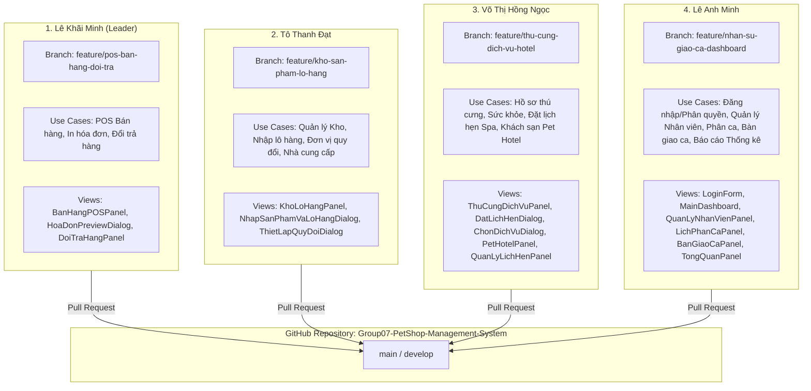

# KẾ HOẠCH THIẾT KẾ GITHUB REPO & PHÂN CHIA CÔNG VIỆC NHÓM 07
> **Học phần:** Phát triển ứng dụng (Application Development - AD) | HK1 2026-2027  
> **Đề tài:** Hệ Thống Quản Lý Cửa Hàng Thú Cưng (Pet Shop Management System)  
> **Thành viên:** Lê Khãi Minh (Leader), Lê Anh Minh, Tô Thanh Đạt, Võ Thị Hồng Ngọc  
> **Mục tiêu sống còn:** Xây dựng lại GitHub Repository chuẩn chỉ, phân bổ đều công việc cho 4 thành viên, băm nhỏ commit để biểu đồ đóng góp (GitHub Contributors / Insights) xanh đều, rõ ràng tiến độ, tránh bị giảng viên đánh rớt môn.

---

## I. NGUYÊN NHÂN LỖI ĐỒ THỊ VÀ QUY TẮC BẮT BUỘC CỦA GITHUB

Trong hình ảnh minh họa bạn gửi:
- 1 thành viên chiếm **105 commits (hơn 80% code)**, các bạn còn lại chỉ có **19 commits, 8 commits, 2 commits**.
- Giảng viên chấm điểm tiến độ dựa trực tiếp vào tab **Insights -> Contributors**. Nếu biểu đồ lệch như vậy, giảng viên sẽ kết luận: **1 người gánh team, các thành viên khác không làm bài** $\rightarrow$ Trừ điểm nặng hoặc cho rớt môn.

### 3 Quy Tắc Bắt Buộc Để GitHub Ghi Nhận Đúng Từng Người:
1. **Email trên máy tính phải trùng với email tài khoản GitHub:**
   Trước khi gõ lệnh commit, từng thành viên PHẢI mở Terminal trên máy mình chạy 2 lệnh sau:
   ```bash
   git config --global user.name "Tên GitHub Của Bạn"
   git config --global user.email "email_dang_ky_github@gmail.com"
   ```
   > [!IMPORTANT]
   > Nếu không cấu hình đúng email đã add trong tài khoản GitHub cá nhân, commit sẽ bị gán thành "Anonymous" hoặc của người khác, GitHub sẽ **KHÔNG hiển thị avatar và KHÔNG cộng điểm vào biểu đồ Contributors**!

2. **Không bao giờ push trực tiếp đống code lớn vào nhánh `main`:**
   Mỗi người phải checkout ra một nhánh riêng dạng `feature/ten-chuc-nang`, code từng phần nhỏ rồi commit, sau đó mở Pull Request (PR) merge vào nhánh chính.

3. **Nguyên tắc "Băm nhỏ commit" (Atomic Commits):**
   Không bao giờ làm xong cả màn hình rồi mới gõ `git add . && git commit -m "done UI"`.
   Phải băm nhỏ thành 15 - 25 commit/thành viên theo từng giai đoạn: *Tạo Entity $\rightarrow$ Viết DAO $\rightarrow$ Vẽ Frame/Panel $\rightarrow$ Viết Controller $\rightarrow$ Bắt sự kiện $\rightarrow$ Validate $\rightarrow$ Sửa giao diện $\rightarrow$ Test*.

---

## II. BẢNG PHÂN CHIA CÔNG VIỆC CHI TIẾT (4 THÀNH VIÊN)

Dự án được bóc tách cân bằng thành **4 phân hệ độc lập**, mỗi thành viên phụ trách trọn vẹn từ **Giao diện (View) $\rightarrow$ Logic nghiệp vụ (Controller) $\rightarrow$ Truy vấn CSDL (DAO) $\rightarrow$ Thực thể (Entity)**.



---

### CHI TIẾT CÔNG VIỆC TỪNG THÀNH VIÊN:

### 1. Lê Khãi Minh (Team Leader)
- **Nhánh phụ trách:** `feature/pos-ban-hang-doi-tra`
- **Phân hệ:** Quản trị Bán hàng tại quầy (POS), In hóa đơn & Xử lý đổi trả hàng.
- **Nghiệp vụ & Use Cases:**
  - `UC-POS-01`: Tra cứu nhanh sản phẩm qua Barcode / Tên / Danh mục trên màn hình bán hàng.
  - `UC-POS-02`: Chọn đơn vị tính quy đổi (Lon, Hộp, Thùng, Gói), tự động tính thành tiền theo đơn giá quy đổi.
  - `UC-POS-03`: Tích điểm thành viên, áp dụng chiết khấu/giảm giá, chọn hình thức thanh toán (Tiền mặt/Chuyển khoản).
  - `UC-POS-04`: Xuất hóa đơn bán lẻ, preview giao diện in hóa đơn (`HoaDonPreviewDialog`).
  - `UC-POS-05`: Xử lý đổi trả hàng (`PhieuDoiTra`), kiểm tra hạn đổi trả từ hóa đơn gốc, tính tiền hoàn trả khách và hoàn kho.
- **Giao diện (View):**
  - `src/views/BanHangPOSPanel.java`
  - `src/views/HoaDonPreviewDialog.java`
  - `src/views/DoiTraHangPanel.java`
- **Controller & Logic:**
  - `src/controllers/BanHangController.java`
- **DAO & Entity:**
  - DAO: `HoaDonDAO.java`, `KhachHangDAO.java`
  - Entity: `HoaDon.java`, `ChiTietHoaDon.java`, `ChiTietXuatLo.java`, `PhieuDoiTra.java`, `ChiTietDoiTra.java`, `KhachHang.java`

---

### 2. Tô Thanh Đạt
- **Nhánh phụ trách:** `feature/kho-san-pham-lo-hang`
- **Phân hệ:** Quản lý Kho, Danh mục Sản phẩm, Lô hàng & Thiết lập Quy đổi đơn vị.
- **Nghiệp vụ & Use Cases:**
  - `UC-KHO-01`: Quản lý danh mục hàng hóa & sản phẩm (CRUD sản phẩm, phân loại danh mục thức ăn, phụ kiện, thuốc).
  - `UC-KHO-02`: Thiết lập bảng quy đổi đơn vị tính (`DonViTinh`, `QuyDoiDonVi`, thiết lập đơn vị cơ sở và tỷ lệ quy đổi giá bán).
  - `UC-KHO-03`: Lập phiếu nhập kho theo Lô hàng (`LoHang`), quản lý thông tin nhà cung cấp (`NhaCungCap`), giá vốn nhập cơ sở.
  - `UC-KHO-04`: Theo dõi hạn sử dụng (cảnh báo hàng sắp hết hạn/cận date), theo dõi tồn kho an toàn và số lượng tồn cơ sở.
- **Giao diện (View):**
  - `src/views/KhoLoHangPanel.java`
  - `src/views/NhapSanPhamVaLoHangDialog.java`
  - `src/views/ThietLapQuyDoiDialog.java`
- **Controller & Logic:**
  - Tạo mới: `src/controllers/KhoHangController.java` (hoặc `SanPhamController.java`)
- **DAO & Entity:**
  - DAO: `SanPhamDAO.java`, `LoHangDAO.java`
  - Entity: `SanPham.java`, `DanhMucHang.java`, `LoHang.java`, `NhaCungCap.java`, `DonViTinh.java`, `QuyDoiDonVi.java`

---

### 3. Võ Thị Hồng Ngọc
- **Nhánh phụ trách:** `feature/thu-cung-dich-vu-hotel`
- **Phân hệ:** Quản lý Hồ sơ Thú cưng, Dịch vụ Chăm sóc/Spa & Khách sạn thú cưng (Pet Hotel).
- **Nghiệp vụ & Use Cases:**
  - `UC-PET-01`: Quản lý hồ sơ thú cưng (`HoSoThuCung`, `ThuCung`), số Microchip, thông tin chủ nuôi, giống loài, ngày sinh.
  - `UC-PET-02`: Ghi nhận hồ sơ sức khỏe (`HoSoSucKhoe`), kiểm tra cân nặng, nhiệt độ, ve rận, lịch sử tiêm phòng dại.
  - `UC-PET-03`: Quản lý bảng giá danh mục Dịch vụ (Spa, tắm sấy, cắt tỉa lông, vệ sinh tai móng, khám tổng quát).
  - `UC-PET-04`: Đặt và tiếp nhận lịch hẹn dịch vụ (`LichHen`, `ChiTietLichHen`), điều phối Kỹ thuật viên (KTV) thực hiện.
  - `UC-PET-05`: Quản lý phòng lưu trú khách sạn thú cưng (`PetHotelPanel`), check-in phòng, theo dõi chế độ ăn, check-out tính tiền.
- **Giao diện (View):**
  - `src/views/ThuCungDichVuPanel.java`
  - `src/views/DatLichHenDialog.java`
  - `src/views/ChonDichVuDialog.java`
  - `src/views/QuanLyLichHenPanel.java`
  - `src/views/PetHotelPanel.java`
- **Controller & Logic:**
  - `src/controllers/ThuCungController.java`
- **DAO & Entity:**
  - DAO: `ThuCungDAO.java`, `DichVuDAO.java`, `LichHenDAO.java`
  - Entity: `ThuCung.java`, `HoSoThuCung.java`, `HoSoSucKhoe.java`, `DichVu.java`, `LichHen.java`, `ChiTietLichHen.java`, `ChiTietDichVu.java`

---

### 4. Lê Anh Minh
- **Nhánh phụ trách:** `feature/nhan-su-giao-ca-dashboard`
- **Phân hệ:** Quản lý Nhân sự, Phân ca làm việc, Bàn giao ca & Báo cáo Tổng quan Dashboard.
- **Nghiệp vụ & Use Cases:**
  - `UC-HR-01`: Xác thực đăng nhập hệ thống (`LoginForm`, `TaiKhoan`), mã hóa mật khẩu, phân quyền vai trò (Admin, Thu ngân, KTV).
  - `UC-HR-02`: Quản lý hồ sơ nhân viên (`QuanLyNhanVienPanel`, `NhanVien`), thêm sửa trạng thái công tác, số điện thoại, chức vụ.
  - `UC-HR-03`: Quản lý ca làm việc và phân công lịch trực tuần (`CaLamViec`, `BangPhanCong`, `LichPhanCaPanel`).
  - `UC-HR-04`: Nghiệp vụ Bàn giao ca (`BanGiaoCaPanel`, `BangGiaoCa`), khai báo tiền đầu ca, kết ca, đối soát tiền thực tế vs hệ thống, ghi nhận chênh lệch.
  - `UC-HR-05`: Khung điều hướng chính (`MainDashboard`), biểu đồ báo cáo doanh thu ngày/tuần/tháng, sản phẩm bán chạy (`TongQuanPanel`, `BaoCaoThongKeDialog`).
- **Giao diện (View):**
  - `src/views/LoginForm.java`
  - `src/views/MainDashboard.java`
  - `src/views/QuanLyNhanVienPanel.java`
  - `src/views/LichPhanCaPanel.java`
  - `src/views/BanGiaoCaPanel.java`
  - `src/views/TongQuanPanel.java` & `src/views/BaoCaoThongKeDialog.java` & `src/views/charts/`
- **Controller & Logic:**
  - `src/controllers/DangNhapController.java`
  - `src/controllers/NhanVienController.java`
  - `src/controllers/PhanCaController.java`
  - `src/controllers/GiaoCaController.java`
- **DAO & Entity:**
  - DAO: `TaiKhoanDAO.java`, `NhanVienDAO.java`, `BangGiaoCaDAO.java`
  - Entity: `NhanVien.java`, `TaiKhoan.java`, `CaLamViec.java`, `BangPhanCong.java`, `BangGiaoCa.java`

---

## III. CHIẾN LƯỢC BĂM NHỎ COMMIT (MICRO-COMMITS) CHO TỪNG THÀNH VIÊN

Để mỗi người có từ **15 - 25 commits** trải đều trên GitHub, mỗi thành viên KHÔNG commit cả cụm mà chia nhỏ từng thao tác theo kịch bản chuẩn sau:

### Kịch bản băm nhỏ 16 commits mẫu (Áp dụng cho mọi thành viên):

```mermaid
flowchart LR
    C1[1. Model Entity] --> C2[2. DAO Skeleton]
    C2 --> C3[3. DAO Read SQL]
    C3 --> C4[4. DAO Write SQL]
    C4 --> C5[5. Layout View]
    C5 --> C6[6. JTable & Form]
    C6 --> C7[7. Controller Init]
    C7 --> C8[8. Load Data Event]
    C8 --> C9[9. Add Event]
    C9 --> C10[10. Edit/Delete Event]
    C10 --> C11[11. Validation Logic]
    C11 --> C12[12. Dialog / Popup]
    C12 --> C13[13. Style & FlatLaf]
    C13 --> C14[14. Unit Test]
    C14 --> C15[15. Fix Bug & Refactor]
    C15 --> C16[16. PR & Docs Update]
```



### Danh sách Commit Messages mẫu từng thành viên có thể sao chép gõ theo:

#### Ví dụ nhánh của Tô Thanh Đạt (`feature/kho-san-pham-lo-hang`):
1. `git commit -m "feat(entity): create SanPham, DanhMucHang, and LoHang entities"`
2. `git commit -m "feat(entity): add QuyDoiDonVi and DonViTinh with unit test conversions"`
3. `git commit -m "feat(dao): create SanPhamDAO with getAllSanPham and searchByName"`
4. `git commit -m "feat(dao): implement add, update, and delete in SanPhamDAO"`
5. `git commit -m "feat(dao): create LoHangDAO with batch tracking and expiry date filter"`
6. `git commit -m "feat(view): build base layout and toolbar for KhoLoHangPanel"`
7. `git commit -m "feat(view): implement JTable for stock tracking with custom renderers"`
8. `git commit -m "feat(view): design NhapSanPhamVaLoHangDialog for goods receipt"`
9. `git commit -m "feat(view): design ThietLapQuyDoiDialog for unit conversion"`
10. `git commit -m "feat(controller): setup KhoHangController to bridge View and DAO"`
11. `git commit -m "feat(controller): handle add product and batch receipt events"`
12. `git commit -m "feat(controller): add search, category filtering, and expiry warnings"`
13. `git commit -m "feat(validation): validate product barcode, quantity, and unit price"`
14. `git commit -m "fix(ui): polish FlatLaf styling and table row selection colors"`
15. `git commit -m "test: add VerifyKhoModule unit test for stock calculations"`
16. `git commit -m "docs: update worklog for Kho and LoHang module completion"`

*(Tương tự, Võ Thị Hồng Ngọc, Lê Anh Minh và Lê Khãi Minh cũng băm thành 15-20 commit theo trình tự trên cho các file thuộc phân hệ của mình).*

---

## IV. QUY TRÌNH THỰC HIỆN TỪNG BƯỚC (STEP-BY-STEP)

### Bước 1: Tạo Repository mới trên GitHub (Leader thực hiện)
1. Leader đăng nhập GitHub, tạo Repository mới (public hoặc share quyền cộng tác viên cho 3 bạn):
   - Tên repo: `Group07-PetShop-Management-System`
2. Leader chỉ push **Bộ khung cơ bản (Init Skeleton)**:
   - File cấu hình: `.gitignore`, `README.md`
   - File Database DDL: `database/scripts/01_schema.sql`, `database/seeds/02_sample_data.sql`
   - Các file dùng chung: `src/utils/DBConnection.java`, `src/utils/ThemeColors.java`, `src/utils/IconHelper.java`, `src/Main.java`
   - Commit: `feat: initialize project skeleton, database schema, and shared utilities`
3. Leader tạo nhánh `develop` từ `main`:
   ```bash
   git branch develop
   git push origin develop
   ```

### Bước 2: 3 Thành viên clone về máy và tạo nhánh riêng
Mỗi thành viên chạy trên máy mình:
```bash
git clone https://github.com/<ten-user>/Group07-PetShop-Management-System.git
cd Group07-PetShop-Management-System
git checkout develop
git checkout -b feature/<ten-nhanh-cua-ban>
```

### Bước 3: Đưa code vào theo từng phần và thực hiện Micro-commits
Mỗi bạn lấy code tương ứng với phân hệ được phân chia ở Mục II:
- Đưa từng file Entity vào $\rightarrow$ `git add ...` $\rightarrow$ `git commit`
- Đưa DAO vào $\rightarrow$ `git add ...` $\rightarrow$ `git commit`
- Đưa View vào $\rightarrow$ `git add ...` $\rightarrow$ `git commit`
- Đưa Controller vào $\rightarrow$ `git add ...` $\rightarrow$ `git commit`
- Push nhánh của mình lên GitHub:
  ```bash
  git push origin feature/<ten-nhanh-cua-ban>
  ```

### Bước 4: Mở Pull Request (PR) và Review chéo
1. Lên giao diện GitHub, bấm **Compare & pull request** từ `feature/<nhanh>` vào `develop`.
2. Gắn bạn cùng nhóm làm **Reviewer**.
3. Bạn cùng nhóm bấm **Approve** $\rightarrow$ Bấm **Merge pull request**!
4. Cuối cùng khi cả 4 nhánh đã gộp vào `develop`, Leader tạo PR gộp từ `develop` vào `main`.

---

## V. KẾT QUẢ ĐẠT ĐƯỢC KHI NỘP BÀI CHO GIẢNG VIÊN

| Tiêu chí giảng viên kiểm tra | Trước đây | Sau khi áp dụng kế hoạch này |
| :--- | :--- | :--- |
| **Biểu đồ Contributors (Insights)** | 1 người 100 commits, 3 người gần như 0 | Cả 4 người đều có **15 - 30 commits**, biểu đồ trải đều các tuần |
| **Phân chia công việc** | Không rõ ai làm gì, nghi ngờ copy | 4 nhánh rõ ràng, mỗi bạn sở hữu usecase, view, controller riêng |
| **Lịch sử Git (Commit log)** | 1 commit to đùng `push code` | Chuẩn `Conventional Commits` (`feat`, `fix`, `docs`, `test`) |
| **Lịch sử Pull Request** | Trống không | Đầy đủ 4-8 PR có bình luận, duyệt chéo giữa các thành viên |
| **Đánh giá cá nhân của GV** | Nguy cơ rớt 3 người | Đạt điểm tối đa phần làm việc nhóm và đóng góp cá nhân |
