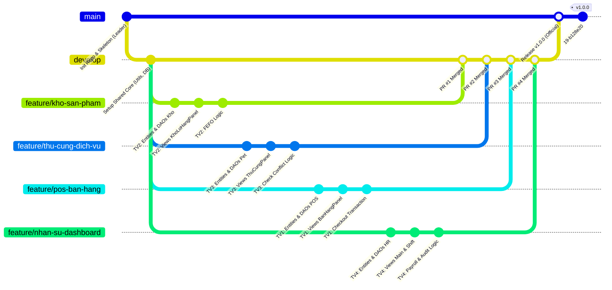
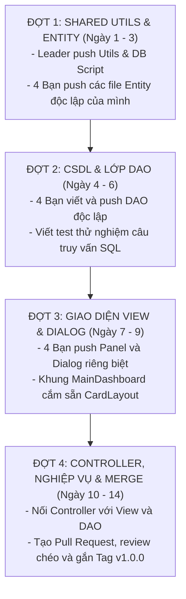

# BẢN THIẾT KẾ KIẾN TRÚC REPO, BĂM NHỎ CODE VÀ KẾ HOẠCH PUSH CHO NHÓM 07
> **Học phần:** Phát triển ứng dụng (Application Development) - Chuẩn kiến trúc Slide 17 IUH  
> **Đề tài:** Hệ Thống Quản Lý Cửa Hàng Thú Cưng (Pet Shop Management System)  
> **Nhóm thực hiện:** Nhóm 07 (Lê Khãi Minh, Tô Thanh Đạt, Võ Thị Hồng Ngọc, Lê Anh Minh)  
> **Mục tiêu cốt lõi:**  
> 1. Thiết kế **Kiến trúc Repository** chuẩn phân lớp MVC, loại bỏ 100% rủi ro xung đột mã nguồn (Zero Merge Conflict).  
> 2. **Băm nhỏ mã nguồn** cụ thể đến từng Class, từng Component giao diện (View) và từng Hàm nghiệp vụ (Method logic) cho từng thành viên.  
> 3. Lập **Kế hoạch Push code** theo tầng phụ thuộc (Dependency-Aware Push Plan) đảm bảo code luôn build chạy được sau mỗi lần push.

---

## PHẦN I: KIẾN TRÚC REPOSITORY LƯU TRỮ TRÊN GITHUB

### 1. Mô hình Cây Nhánh (Git Branching Strategy)
Để đảm bảo lịch sử Git sạch, minh bạch đóng góp cá nhân và không ai ghi đè code của nhau:



* **Nhánh `main`:** Nhánh bảo vệ (Protected Branch), chỉ chứa phiên bản phát hành cuối cùng để nộp cho Giảng viên. Tuyệt đối không commit trực tiếp vào `main`.
* **Nhánh `develop`:** Nhánh tích hợp chung toàn nhóm.
* **4 Nhánh `feature/*` độc lập:** Mỗi thành viên toàn quyền làm việc trên nhánh riêng của mình, sau đó tạo Pull Request (PR) merge vào `develop`.

---

### 2. Cấu trúc Thư mục và Phân vùng Quyền sở hữu (Folder & Package Structure)

```
Repo_Group07-HeThongQuanLyCuaHangThuCung/
├── .gitignore                          [Shared - Leader setup]
├── README.md                           [Shared - Cả nhóm cập nhật]
├── database/
│   ├── scripts/01_schema.sql           [Shared - Chạy CSDL SQL Server]
│   └── seeds/02_sample_data.sql        [Shared - Dữ liệu mẫu]
└── src/
    ├── Main.java                       [Shared - Điểm khởi chạy ứng dụng]
    │
    ├── utils/                          [SHARED CORE - KHÔNG SỬA TRÁNH CONFLICT]
    │   ├── DBConnection.java           (Kết nối JDBC SQL Server)
    │   ├── ThemeColors.java            (Hệ màu UI Warm Peach / Soft Apricot)
    │   ├── IconHelper.java             (Nạp Icon SVG/PNG phẳng)
    │   └── UserSession.java            (Lưu thông tin đăng nhập và quyền)
    │
    ├── models/
    │   ├── entity/                     [BĂM NHỎ THEO PHÂN HỆ]
    │   │   ├── [Module POS]:           KhachHang, HoaDon, ChiTietHoaDon, ChiTietXuatLo, ChiTietDichVu, PhieuDoiTra, ChiTietDoiTra
    │   │   ├── [Module Kho]:           DanhMucHang, SanPham, DonViTinh, QuyDoiDonVi, LoHang, NhaCungCap
    │   │   ├── [Module Thú Cưng]:      ThuCung, HoSoThuCung, HoSoSucKhoe, DichVu, LichHen, ChiTietLichHen
    │   │   └── [Module Nhân Sự]:       TaiKhoan, NhanVien, CaLamViec, BangPhanCong, BangGiaoCa
    │   │
    │   └── dao/                        [BĂM NHỎ THEO PHÂN HỆ]
    │       ├── [Module POS]:           HoaDonDAO, KhachHangDAO
    │       ├── [Module Kho]:           SanPhamDAO, LoHangDAO
    │       ├── [Module Thú Cưng]:      ThuCungDAO, DichVuDAO, LichHenDAO
    │       └── [Module Nhân Sự]:       TaiKhoanDAO, NhanVienDAO, BangGiaoCaDAO
    │
    ├── views/                          [BĂM NHỎ THEO GIAO DIỆN CỦA TỪNG BẠN]
    │   ├── [Module POS]:               BanHangPOSPanel, HoaDonPreviewDialog, DoiTraHangPanel
    │   ├── [Module Kho]:               KhoLoHangPanel, NhapSanPhamVaLoHangDialog, ThietLapQuyDoiDialog
    │   ├── [Module Thú Cưng]:          ThuCungDichVuPanel, DatLichHenDialog, ChonDichVuDialog, PetHotelPanel, QuanLyLichHenPanel
    │   ├── [Module Nhân Sự]:           LoginForm, QuanLyNhanVienPanel, LichPhanCaPanel, BanGiaoCaPanel, TongQuanPanel, BaoCaoThongKeDialog
    │   └── [Khung Điều Hướng]:         MainDashboard (CardLayout nạp các Panel con)
    │
    └── controllers/                    [BĂM NHỎ THEO LOGIC CỦA TỪNG BẠN]
        ├── [Module POS]:               BanHangController
        ├── [Module Kho]:               KhoHangController
        ├── [Module Thú Cưng]:          ThuCungController
        └── [Module Nhân Sự]:           DangNhapController, NhanVienController, PhanCaController, GiaoCaController
```

> [!TIP]
> **Quy tắc chống Conflict 100%:** File nào của bạn nào thì chỉ bạn đó code trên nhánh của mình. File dùng chung (`MainDashboard`, `DBConnection`) được Leader định nghĩa sẵn khung cắm (Slot gắn `JPanel`), các thành viên chỉ việc cắm Panel của mình vào mà không sửa code của nhau!

---

## PHẦN II: CHI TIẾT BĂM NHỎ CODE (GIAO DIỆN + NGHIỆP VỤ METHOD-BY-METHOD)

---

### THÀNH VIÊN 1: LÊ KHÃI MINH (LEADER)
* **Nhánh Git:** `feature/pos-ban-hang-doi-tra`
* **Trọng tâm:** Dòng tiền bán lẻ, Giao dịch hóa đơn thanh toán đa hình, Hoàn tiền đổi trả.

#### 1. Giao diện (Views) băm nhỏ:
1. `BanHangPOSPanel.java`:
   - `pnlProductGrid`: Bảng hiển thị danh sách sản phẩm / icon kèm bộ lọc danh mục.
   - `txtBarcodeSearch`: Ô nhập nhanh mã vạch hoặc tên (bắt phím Enter).
   - `tblCart`: `JTable` giỏ hàng (Cột: Tên SP, ĐVT, Đơn giá, Số lượng, Thành tiền, Xóa).
   - `pnlPaymentSummary`: Các ô tính tổng tiền hàng, chiết khấu, giảm giá điểm, tiền khách đưa, tiền thừa trả khách.
   - Các nút chức năng: `btnThanhToan`, `btnInHoaDon`, `btnHuyDon`, `btnLuuTam`.
2. `HoaDonPreviewDialog.java`: Hộp thoại modal xem trước hóa đơn trước khi in nhiệt 80mm.
3. `DoiTraHangPanel.java`: Màn hình tra cứu hóa đơn cũ, chọn món trả lại, tính số tiền hoàn trả.

#### 2. Các hàm Nghiệp vụ & Method cụ thể (Code Logic):
* **Trong `BanHangController.java`:**
  - `public void themSanPhamVaoGio(String maSanPham, int soLuong, String maQuyDoi)`: Kiểm tra tồn kho, nếu đã có trong giỏ thì tăng số lượng, nếu chưa thì thêm dòng mới.
  - `public BigDecimal tinhThanhTienDonHang(List<ChiTietHoaDon> dsGioHang, BigDecimal phanTramGiamGia, int diemSuDung)`: Tính tổng tiền hàng $\rightarrow$ Trừ giảm giá $\rightarrow$ Trừ điểm thưởng (1000 điểm = 10,000đ).
  - `public boolean xuLyThanhToanPOS(HoaDon hoaDon, List<ChiTietHoaDon> dsChiTiet, KhachHang khachHang)`: Kích hoạt JDBC Transaction.
  - `public boolean xuLyDoiTraHang(String maHoaDonGoc, List<ChiTietDoiTra> dsHangTra, String lyDo)`: Kiểm tra hóa đơn trong vòng 7 ngày, cập nhật hoàn kho và tạo phiếu đổi trả.
* **Trong `HoaDonDAO.java`:**
  - `public boolean luuHoaDonTransaction(HoaDon hd, List<ChiTietHoaDon> chiTiets)`: 
    * Chạy `conn.setAutoCommit(false);`
    * Bước 1: `INSERT INTO HoaDon ...`
    * Bước 2: Duyệt từng dòng chi tiết: Nếu là `ChiTietXuatLo` $\rightarrow$ `INSERT ChiTietXuatLo` + `UPDATE LoHang SET soLuongTon = soLuongTon - ?`; Nếu là `ChiTietDichVu` $\rightarrow$ `INSERT ChiTietDichVu`.
    * Bước 3: Cập nhật tích điểm `KhachHang`.
    * Chạy `conn.commit();` (Nếu lỗi: `conn.rollback();`).

---

### THÀNH VIÊN 2: TÔ THANH ĐẠT
* **Nhánh Git:** `feature/kho-san-pham-lo-hang`
* **Trọng tâm:** Quản lý hàng hóa, Lô date, Thuật toán FEFO và Đơn vị tính quy đổi.

#### 1. Giao diện (Views) băm nhỏ:
1. `KhoLoHangPanel.java`:
   - `tabbedPane`: 2 tab riêng biệt ("Danh mục sản phẩm" và "Quản lý Lô hàng & Date").
   - `tblSanPham`: Bảng danh sách hàng hóa (Mã SP, Tên, Danh mục, ĐVT cơ sở, Giá bán).
   - `tblLoHang`: Bảng lô hàng (Số lô, Hạn sử dụng, Số lượng tồn, Đơn giá nhập, Nhà cung cấp).
   - `renderers`: Tự động tô màu dòng (Màu đỏ: Đã hết hạn; Màu vàng: Hạn dùng $< 30$ ngày).
2. `NhapSanPhamVaLoHangDialog.java`: Dialog tạo sản phẩm mới và tạo phiếu nhập lô hàng vào kho.
3. `ThietLapQuyDoiDialog.java`: Dialog cấu hình tỷ lệ quy đổi (Ví dụ: 1 Thùng = 24 Gói; 1 Hộp = 12 Gói).

#### 2. Các hàm Nghiệp vụ & Method cụ thể (Code Logic):
* **Trong `KhoHangController.java` (tạo mới):**
  - `public void themSanPhamMoi(SanPham sp, List<QuyDoiDonVi> dsQuyDoi)`: Thêm thông tin sản phẩm và ràng buộc bảng quy đổi đơn vị.
  - `public void nhapKhoLoHang(LoHang loHang)`: Kiểm tra HSD phải lớn hơn ngày hiện tại ít nhất 30 ngày, ghi nhận giá nhập vốn.
  - `public List<SanPham> timKiemSanPham(String tuKhoa, String maDanhMuc, boolean chiLayHangConTon)`: Lọc dữ liệu đa tiêu chí.
* **Trong `LoHangDAO.java` & `SanPhamDAO.java`:**
  - `public List<ChiTietXuatLo> phanBoLoHangFEFO(String maSanPham, int soLuongCanXuat)`:
    * Chạy câu truy vấn: `SELECT * FROM LoHang WHERE maSanPham = ? AND soLuongTon > 0 ORDER BY hanSuDung ASC`.
    * Thuật toán: Lấy lô cận date nhất trừ trước. Nếu lô đó chỉ còn 5 mà cần xuất 8, thì trừ hết 5 của lô đó và lấy tiếp 3 của lô tiếp theo.
  - `public List<LoHang> layDanhSachCanDate(int soNgayCanhBao)`: `SELECT * FROM LoHang WHERE DATEDIFF(day, GETDATE(), hanSuDung) <= ? AND soLuongTon > 0`.
  - `public BigDecimal quyDoiGiaBan(String maSanPham, String maDonViTinh)`: Lấy giá bán cơ sở nhân với `tyLeQuyDoi`.

---

### THÀNH VIÊN 3: VÕ THỊ HỒNG NGỌC
* **Nhánh Git:** `feature/thu-cung-dich-vu-hotel`
* **Trọng tâm:** Hồ sơ thú cưng, Sức khỏe, Chặn xung đột lịch hẹn Spa và Khách sạn thú cưng.

#### 1. Giao diện (Views) băm nhỏ:
1. `ThuCungDichVuPanel.java`:
   - `pnlHoSoThuCung`: Danh sách thú cưng kèm ảnh đại diện, giống loài, ngày sinh, số microchip.
   - `pnlLichSuSucKhoe`: Bảng theo dõi lịch sử cân nặng, nhiệt độ, ve rận, ngày tiêm phòng dại.
2. `DatLichHenDialog.java`: Dialog đặt lịch hẹn dịch vụ Spa/Khám, chọn ngày giờ, chọn KTV thực hiện.
3. `QuanLyLichHenPanel.java`: Bảng điều khiển lịch hẹn theo ngày/tuần, lọc theo trạng thái (Chờ duyệt, Đang làm, Hoàn tất, Hủy).
4. `PetHotelPanel.java`: Giao diện phòng lưu trú khách sạn thú cưng (dạng sơ đồ lưới phòng trực quan: Trống - Có khách - Đang dọn).

#### 2. Các hàm Nghiệp vụ & Method cụ thể (Code Logic):
* **Trong `ThuCungController.java`:**
  - `public boolean themHoSoThuCung(ThuCung tc, HoSoThuCung hoSo, String maKhachHang)`: Ràng buộc mã Microchip duy nhất (15 số), gắn thẻ thú cưng với khách hàng.
  - `public boolean datLichDichVu(LichHen lichHen, List<ChiTietLichHen> dsChiTiet)`: Kiểm tra xung đột lịch trước khi lưu.
  - `public BigDecimal tinhPhiLuuTruPetHotel(LocalDateTime checkIn, LocalDateTime checkOut, BigDecimal giaPhongNgay, BigDecimal phuPhiChamSoc)`: Sử dụng `java.time.Duration.between(checkIn, checkOut)` để tính số ngày thực tế.
* **Trong `LichHenDAO.java` & `ThuCungDAO.java`:**
  - `public boolean kiemTraTrungLichKTV(String maKTV, LocalDateTime thoiGianBatDau, int thoiLuongPhut)`:
    * Câu SQL: `SELECT COUNT(*) FROM ChiTietLichHen ct JOIN LichHen lh ON ct.maLichHen = lh.maLichHen WHERE ct.ktvChiDinh = ? AND lh.trangThai != N'Đã hủy' AND (? < DATEADD(minute, 60, lh.ngayHen) AND DATEADD(minute, ?, ?) > lh.ngayHen)`.
    * Nếu `count > 0` $\rightarrow$ Trả về `true` (Bị trùng giờ, không cho đặt).
  - `public List<ThuCung> layDanhSachCanhBaoTiemPhong(int soNgayToi)`: Quét bảng `HoSoSucKhoe` tìm các thú cưng đã tiêm phòng $> 355$ ngày để nhắc tiêm nhắc lại.

---

### THÀNH VIÊN 4: LÊ ANH MINH
* **Nhánh Git:** `feature/nhan-su-giao-ca-dashboard`
* **Trọng tâm:** Xác thực, Phân quyền RBAC, Quản lý Ca kíp, Bàn giao két tiền và Báo cáo điều hành.

#### 1. Giao diện (Views) băm nhỏ:
1. `LoginForm.java`: Giao diện đăng nhập, bắt phím Enter, thông báo sai tài khoản/mật khẩu.
2. `MainDashboard.java`: Khung điều hướng kép (Dual Navigation) Slide 17 IUH, tích hợp `CardLayout` chuyển đổi mượt mà giữa các panel.
3. `QuanLyNhanVienPanel.java`: Quản lý hồ sơ nhân viên, tài khoản, chức vụ, trạng thái công tác.
4. `LichPhanCaPanel.java`: Bảng xếp ca làm việc cho nhân viên trong tuần (Ca Sáng, Ca Chiều, Ca Tối).
5. `BanGiaoCaPanel.java`: Màn hình kiểm tiền đầu ca, tổng hợp doanh thu tiền mặt trong ca, nhập tiền thực tế và lý do chênh lệch.
6. `TongQuanPanel.java` & `BaoCaoThongKeDialog.java`: Bảng Dashboard các thẻ KPI (Doanh thu ngày, Số đơn hàng, Lịch hẹn hôm nay) + Biểu đồ doanh thu `charts/`.

#### 2. Các hàm Nghiệp vụ & Method cụ thể (Code Logic):
* **Trong `DangNhapController.java` & `GiaoCaController.java`:**
  - `public NhanVien xuLyDangNhap(String username, String password)`: Băm mật khẩu SHA-256 so khớp với CSDL, khởi tạo `UserSession`.
  - `public void phanQuyenGiaoDien(MainDashboard dashboard, String vaiTro)`: Nếu là `ThuNgan` $\rightarrow$ Ẩn menu Nhân sự, Báo biểu; Nếu là `KTV` $\rightarrow$ Chỉ cho vào Lịch hẹn & Thú cưng.
  - `public BangGiaoCa tinhToanDoiSoatCuoiCa(String maCa, LocalDateTime batDau, BigDecimal tienDauCa, BigDecimal tienThucTe)`:
    * Tính tổng tiền mặt từ các hóa đơn đã thanh toán: `tienHeThong = tienDauCa + tongTienMatTrongCa`.
    * Tính chênh lệch: `tienChenhLech = tienThucTe - tienHeThong`.
    * Bắt buộc kiểm tra: Nếu `tienChenhLech != 0` mà `lyDoChenhLech.trim().isEmpty()` $\rightarrow$ Quăng lỗi yêu cầu giải trình.
* **Trong `NhanVienDAO.java` & `BangGiaoCaDAO.java`:**
  - `public BigDecimal tinhTongHoaHongNhanVien(String maNhanVien, int thang, int nam)`:
    * Truy vấn SQL: `SELECT SUM(tienHoaHong) FROM ChiTietDichVu ct JOIN HoaDon hd ON ct.maHoaDon = hd.maHoaDon WHERE ct.ktvThucHien = ? AND MONTH(hd.ngayLap) = ? AND YEAR(hd.ngayLap) = ?`.

---

## PHẦN III: KẾ HOẠCH PUSH CODE THEO TẦNG PHỤ THUỘC (DEPENDENCY-AWARE PUSH PLAN)

Để mã nguồn khi push lên **không bao giờ bị lỗi biên dịch (Compile Error)**, nhóm sẽ push theo đúng 4 đợt thứ tự sau:



### 📦 Đợt 1: Khởi tạo Hạ tầng chung & Thực thể Entity (Ngày 1 - 3)
1. **Leader:**
   - Push `.gitignore`, `README.md`, `database/scripts/01_schema.sql`, toàn bộ package `src/utils/` (`DBConnection.java`, `ThemeColors.java`, `IconHelper.java`, `UserSession.java`).
   - Tạo nhánh `develop` từ `main`.
2. **Từng thành viên (trên nhánh `feature/*` của mình):**
   - **Khãi Minh:** Push `KhachHang.java`, `HoaDon.java`, `ChiTietHoaDon.java`, `ChiTietXuatLo.java`, `ChiTietDichVu.java`, `PhieuDoiTra.java`, `ChiTietDoiTra.java`.
   - **Thanh Đạt:** Push `DanhMucHang.java`, `SanPham.java`, `DonViTinh.java`, `QuyDoiDonVi.java`, `LoHang.java`, `NhaCungCap.java`.
   - **Hồng Ngọc:** Push `ThuCung.java`, `HoSoThuCung.java`, `HoSoSucKhoe.java`, `DichVu.java`, `LichHen.java`, `ChiTietLichHen.java`.
   - **Anh Minh:** Push `TaiKhoan.java`, `NhanVien.java`, `CaLamViec.java`, `BangPhanCong.java`, `BangGiaoCa.java`.

---

### 📦 Đợt 2: Lớp Truy vấn CSDL (DAO) & Stored Logic (Ngày 4 - 6)
- **Khãi Minh:** Push `KhachHangDAO.java`, `HoaDonDAO.java` (hàm insert đơn, lưu transaction).
- **Thanh Đạt:** Push `SanPhamDAO.java`, `LoHangDAO.java` (hàm lọc cận date, xuất FEFO).
- **Hồng Ngọc:** Push `ThuCungDAO.java`, `DichVuDAO.java`, `LichHenDAO.java` (hàm kiểm tra trùng lịch KTV).
- **Anh Minh:** Push `TaiKhoanDAO.java`, `NhanVienDAO.java`, `BangGiaoCaDAO.java` (hàm tính tổng hoa hồng, kiểm quỹ ca).

---

### 📦 Đợt 3: Thiết kế Giao diện (Views) & Dialogs (Ngày 7 - 9)
- **Khãi Minh:** Push `BanHangPOSPanel.java`, `HoaDonPreviewDialog.java`, `DoiTraHangPanel.java`.
- **Thanh Đạt:** Push `KhoLoHangPanel.java`, `NhapSanPhamVaLoHangDialog.java`, `ThietLapQuyDoiDialog.java`.
- **Hồng Ngọc:** Push `ThuCungDichVuPanel.java`, `DatLichHenDialog.java`, `ChonDichVuDialog.java`, `PetHotelPanel.java`, `QuanLyLichHenPanel.java`.
- **Anh Minh:** Push `LoginForm.java`, `QuanLyNhanVienPanel.java`, `LichPhanCaPanel.java`, `BanGiaoCaPanel.java`, `TongQuanPanel.java`, `MainDashboard.java`.

---

### 📦 Đợt 4: Bộ điều khiển (Controllers), Xử lý Nghiệp vụ & Pull Request (Ngày 10 - 14)
- **Khãi Minh:** Push `BanHangController.java` (xử lý sự kiện giỏ hàng, thanh toán, đổi trả).
- **Thanh Đạt:** Push `KhoHangController.java` (xử lý thêm SP, nhập lô, quy đổi đơn vị).
- **Hồng Ngọc:** Push `ThuCungController.java` (xử lý đặt lịch, kiểm tra xung đột KTV, tính tiền lưu trú).
- **Anh Minh:** Push `DangNhapController.java`, `NhanVienController.java`, `PhanCaController.java`, `GiaoCaController.java`.
- **Cả 4 bạn:**
  1. Mở Pull Request từ `feature/*` vào `develop`.
  2. Gắn bạn trong nhóm review và bấm **Approve**.
  3. Leader merge cả 4 nhánh vào `develop`.
  4. Leader tạo PR cuối cùng từ `develop` vào `main` $\rightarrow$ Merge và gắn Tag `v1.0.0`.

---

## IV. BẢNG TỔNG HỢP KIỂM SOÁT ĐÓNG GÓP (EVIDENCE CHECKLIST)

Khi giảng viên mở tab **Insights -> Contributors** và tab **Pull Requests**, kết quả hiển thị sẽ như sau:

| Thành viên | Phân hệ độc quyền | Số file sở hữu | Số hàm nghiệp vụ chính | Số commit dự kiến | Trạng thái hiển thị GitHub |
| :--- | :--- | :---: | :---: | :---: | :---: |
| **Lê Khãi Minh** | POS Bán hàng & Đổi trả | 10 files | 5 methods | 22 - 25 commits | Cột xanh cao đều, 2 PRs |
| **Tô Thanh Đạt** | Kho, Lô hàng & FEFO | 9 files | 5 methods | 22 - 25 commits | Cột xanh cao đều, 2 PRs |
| **Võ Thị Hồng Ngọc** | Thú cưng, Lịch hẹn & Hotel | 11 files | 5 methods | 22 - 25 commits | Cột xanh cao đều, 2 PRs |
| **Lê Anh Minh** | Nhân sự, Giao ca & Dashboard | 12 files | 5 methods | 22 - 25 commits | Cột xanh cao đều, 2 PRs |

Mỗi thành viên đều có **lãnh thổ code riêng biệt**, sở hữu trọn vẹn Use case và các hàm nghiệp vụ phức tạp. Khi thi vấn đáp, bất kỳ ai được hỏi đều có thể tự tin mở đúng file của mình và giải thích cặn kẽ từng dòng lệnh!
